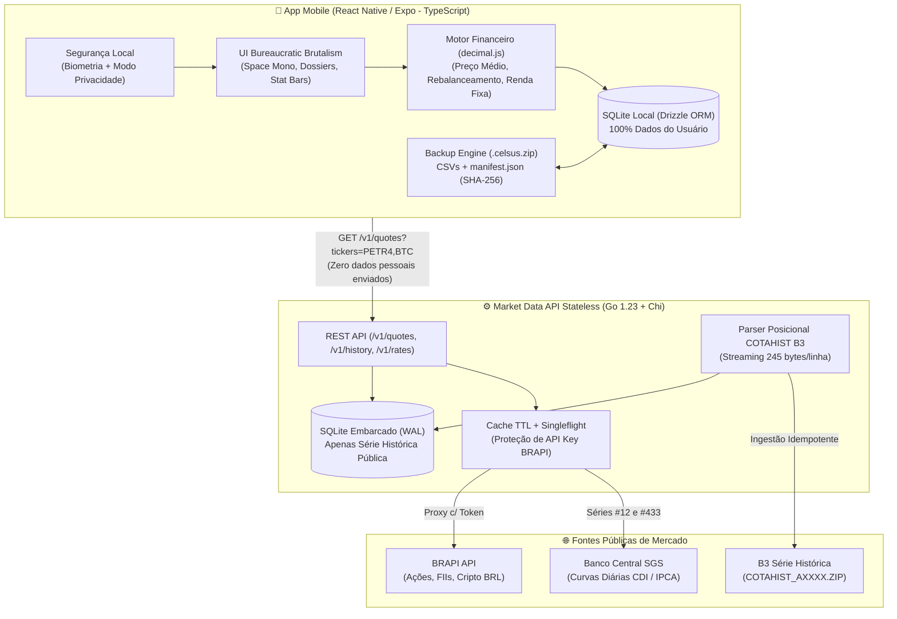

<div align="center">

```text
 ██████╗███████╗██╗     ███████╗██╗   ██╗███████╗
██╔════╝██╔════╝██║     ██╔════╝██║   ██║██╔════╝
██║     █████╗  ██║     ███████╗██║   ██║███████╗
██║     ██╔══╝  ██║     ╚════██║██║   ██║╚════██║
╚██████╗███████╗███████╗███████║╚██████╔╝███████║
 ╚═════╝╚══════╝╚══════╝╚══════╝ ╚═════╝ ╚══════╝
      D O S S I Ê   P A T R I M O N I A L
```

### Gestor Local-First de Carteiras de Investimentos

*Privacidade absoluta no dispositivo, rebalanceamento inteligente em dois níveis e estética Bureaucratic Brutalism.*

[](https://reactnative.dev/)
[](https://expo.dev/)
[](https://www.typescriptlang.org/)
[](https://go.dev/)
[](https://www.sqlite.org/)
[](https://orm.drizzle.team/)

[](#arquitetura-local-first)
[](#motor-de-mercado-cotahist--brapi)
[](#-protocolo-tdd-lock-testes-imutáveis)
[](#-design-system-bureaucratic-brutalism)
[](./LICENSE)

<p align="center">
  <a href="#-sobre-o-projeto">Sobre</a> •
  <a href="#-features-do-mvp">Features</a> •
  <a href="#-arquitetura-local-first">Arquitetura</a> •
  <a href="#-design-system-bureaucratic-brutalism">Design System</a> •
  <a href="#-protocolo-tdd-lock-testes-imutáveis">TDD Lock</a> •
  <a href="#-backlog--roadmap-de-sprints">Backlog & Sprints</a> •
  <a href="#-como-executar">Como Executar</a>
</p>

</div>

---

## 📜 Sobre o Projeto

O **Celsus** é um gestor de carteiras de investimentos mobile desenhado sob o princípio **100% Local-First**: todas as suas carteiras, metas de alocação, saldos e histórico de aportes vivem exclusivamente dentro de um banco **SQLite** no seu celular. Nenhum dado pessoal, conta ou transação é enviado ou armazenado em servidores externos.

Para alimentar os gráficos de evolução patrimonial e cotações em tempo real sem comprometer a privacidade, o Celsus utiliza um **Market Data Engine Stateless em Go**, que processa os arquivos históricos oficiais **COTAHIST da B3**, faz proxy autenticado para a API da **BRAPI** e consolida as curvas diárias de **CDI e IPCA** do Banco Central.

---

## ✨ Features do MVP

| Funcionalidade | Descrição Técnica |
| :--- | :--- |
| 🗂️ **Múltiplas Carteiras + Visão Consolidada** | Crie carteiras independentes (ex.: *Aposentadoria*, *Reserva*, *FIIs*) com metas próprias e acompanhe tudo somado no **Dossiê Geral** em `BRL (R$)`. |
| ⚖️ **Alocação por Pesos em 2 Níveis** | Defina o peso **Macro** de cada classe na carteira (`0–100%`) e o peso **Micro** de cada ativo dentro da classe (`0–100%`), com cálculo automático da meta global ($T_i$). |
| 🧮 **Calculadora Inteligente de Novo Aporte** | Ao digitar um valor em `R$`, o algoritmo distribui o aporte proporcionalmente entre os ativos mais descontados em relação à meta (**rebalanceamento sem vendas**). |
| 📈 **4 Classes de Ativos Nativas** | Suporte completo a **Renda Fixa** (`% CDI`, `IPCA+`, `Pré` em base 252 + saldo manual), **FIIs**, **Ações** e **Criptomoedas** (até 8 casas decimais). |
| 🏛️ **Carga Histórica B3 (`COTAHIST`) + `BRAPI`** | Preços históricos diários extraídos do arquivo posicional de 245 bytes da B3 combinados com cotações recentes via BRAPI. |
| 📓 **Livro-Razão de Aportes e Vendas** | Cálculo automático de **Preço Médio** e **Quantidade Atual**, pré-preenchendo o preço histórico do ativo na data escolhida. |
| 📦 **Backup Criptograficamente Verificado (`.celsus.zip`)** | Exportação/importação offline contendo CSVs editáveis (`portfolios.csv`, `class_targets.csv`, `assets.csv`, `transactions.csv`) + `manifest.json` assinado com `SHA-256` (*Restore* ou *Merge* por UUID). |
| 🔌 **Ready for Open Finance** | Schema SQLite e arquivos de backup já preparados com `source`, `external_id`, `institution_id` e `last_synced_at`. |

---

## 🏗️ Arquitetura Local-First



---

## 🛠️ Stack Tecnológica

### Mobile (`apps/mobile`)


### Backend Stateless (`services/market-api`)


---

## 🎨 Design System: *WalleZ Modern Bento + Paleta Celsus*

A interface do Celsus combina a paleta autoral terrosa/industrial e tipografia `Space Mono` com um layout moderno de **Bento Cards arredondados, Cartão de Saldo Empilhado, Gráficos de Cápsulas e Matriz de Pontos (`Dot-Matrix`)**. Veja a especificação completa em [**`DESIGN_SYSTEM.md`**](./DESIGN_SYSTEM.md).

| Categoria de Ativo | Código no Sistema | Cor & Swatch | Exemplos de Ativos |
| :--- | :--- | :--- | :--- |
| 🏛️ **Renda Fixa** | `FIXED_INCOME` |  *Secondary Teal* | Tesouro Direto, CDB (`% CDI`), LCI/LCA, Debêntures (`IPCA+`, `Pré`) |
| 🏢 **FIIs** | `FII` |  *Tertiary Parchment* | Fundos de Investimento Imobiliário listados na B3 (`HGLG11`, `KNRI11`) |
| ⚡ **Ações** | `STOCK` |  *Primary Amber* | Ações ordinárias, preferenciais e units na B3 (`PETR4`, `WEGE3`) |
| 🪙 **Criptomoedas** | `CRYPTO` |  *Ochre Gold* | Criptoativos cotados em `BRL` com até 8 casas decimais (`BTC`, `ETH`) |
| 📓 **Superfícies** | `SURFACE` |   | Fundo principal `#111315`, Bento Cards `#191B1D` e Dock flutuante |

---

## 🔒 Protocolo TDD Lock (Testes Imutáveis)

Para garantir precisão matemática nas fórmulas financeiras e impedir qualquer adulteração de testes durante o desenvolvimento assistido por IA, o repositório implementa o **Protocolo TDD Lock** ([`.agents/rules/tdd-lock.md`](./.agents/rules/tdd-lock.md)):

1. **Fase A (`Red & Lock`):** Todos os testes da Sprint são criados **antes** do código de produção com base na [`SPEC.md`](./SPEC.md) e trancados com permissão `ReadOnly` + hash criptográfico `SHA-256` em [`tests.lock.json`](./tests.lock.json):
   ```powershell
   powershell -ExecutionPolicy Bypass -File ./scripts/test-lock.ps1 -Action lock
   ```
2. **Fase B (`Green & Verify`):** O código de produção é implementado. **É estritamente proibido editar qualquer arquivo de teste.** Se um teste falhar, o código de produção é corrigido até passar.
3. **Auditoria de Integridade:** Antes de encerrar a Sprint e atualizar o [**`TEST_REPORT.md`**](./TEST_REPORT.md), o verificador valida que nenhum byte dos testes foi modificado:
   ```powershell
   powershell -ExecutionPolicy Bypass -File ./scripts/test-lock.ps1 -Action verify
   ```

---

## 📋 Backlog & Roadmap de Sprints

O acompanhamento detalhado dos casos de teste (`S1-T01` a `S6-T04`) e seus hashes `SHA-256` encontram-se em [**`TEST_REPORT.md`**](./TEST_REPORT.md).

### Fase MVP (Core Local-First)

- [ ] **Sprint 1 — Backend Go: Motor COTAHIST B3, Proxy BRAPI e Curvas Macro**
  - [x] **Fase A:** Escrita e bloqueio `SHA-256` dos 18 testes unitários e de contrato (`S1-T01` a `S1-T09`)
  - [ ] **Fase B:** Implementação do parser posicional de 245 bytes (`COTAHIST`), cliente `BRAPI` com cache TTL, curvas `CDI/IPCA` e endpoints REST `/v1/*`
- [ ] **Sprint 2 — Fundação Mobile Expo, Design System & Banco Local (SQLite + Drizzle)**
  - [ ] **Fase A:** Escrita e bloqueio dos testes de tokens visuais, `AttributeStatBar` e schema SQLite (`S2-T01` a `S2-T03`)
  - [ ] **Fase B:** Configuração do Expo Router, fonte `Space Mono`, componentes *Bureaucratic Brutalism* e migrations Drizzle ORM
- [ ] **Sprint 3 — Gestão de Carteiras, Pesos em 2 Níveis e Motor Financeiro**
  - [ ] **Fase A:** Escrita e bloqueio dos 24 testes de cálculo de Pesos, Preço Médio, Renda Fixa e Calculadora de Aporte (`S3-T01` a `S3-T08`)
  - [ ] **Fase B:** Implementação do motor `decimal.js`, CRUD de múltiplas carteiras e cadastro de ativos nas 4 classes
- [ ] **Sprint 4 — Aportes Manuais, Vendas, Integração COTAHIST/BRAPI e Simulador**
  - [ ] **Fase A:** Escrita e bloqueio dos testes de transações atômicas e auto-preenchimento histórico (`S4-T01` a `S4-T03`)
  - [ ] **Fase B:** Lançamento de Compras/Vendas, extrato em árvore (`Dialogue-Tree Ledger`) e tela do Simulador de Novo Aporte
- [ ] **Sprint 5 — Dashboards (Consolidado e por Carteira) e Gráficos de Evolução Patrimonial**
  - [ ] **Fase A:** Escrita e bloqueio dos testes da curva temporal `investedCapital` vs `marketValue` (`S5-T01` e `S5-T02`)
  - [ ] **Fase B:** Gráficos de Evolução Patrimonial (COTAHIST + CDI), Alocação Atual vs Meta e Detalhe do Ativo
- [ ] **Sprint 6 — Backup/Restore (`.celsus.zip` com CSVs + SHA-256) e Segurança Local**
  - [ ] **Fase A:** Escrita e bloqueio dos testes de exportação ZIP, detecção de adulteração `SHA-256`, Restore/Merge e Privacidade (`S6-T01` a `S6-T04`)
  - [ ] **Fase B:** Serviço completo `.celsus.zip`, Modo Privacidade (`[REDACTED]`) e Bloqueio Biométrico (`expo-local-authentication`)

### Pós-MVP (Roadmap Futuro)
- [ ] 🔗 **Integração Open Finance Brasil:** Sincronização opcional de posições e aportes via conectores Open Finance usando as colunas `external_id` e `institution_id`.
- [ ] 💰 **Dossiê de Proventos:** Controle de Dividendos, JCP e rendimentos mensais de FIIs com gráfico de *Yield on Cost (YoC)*.
- [ ] 🧾 **Apuração Auxiliar de IR:** Relatório anual de custódia, vendas isentas (< R$ 20k em ações) e DARFs.

---

## 📂 Estrutura do Repositório

```text
Celsus/
├── .agents/rules/
│   └── tdd-lock.md                 # Regra always_on de imutabilidade dos testes
├── scripts/
│   └── test-lock.ps1               # CLI de bloqueio ReadOnly e auditoria SHA-256
├── services/
│   └── market-api/                 # Backend Stateless em Go (COTAHIST, BRAPI, BCB Macro)
│       ├── internal/cotahist/      # Parser posicional B3 (245 bytes) + SQLite repo
│       ├── internal/brapi/         # Proxy & Cache de cotações (Ações, FIIs, Cripto BRL)
│       ├── internal/macro/         # Séries históricas diárias de CDI e IPCA
│       └── internal/http/          # Roteador Chi e handlers REST (/v1/*)
├── apps/
│   └── mobile/                     # App React Native (Expo + TypeScript + SQLite local)
├── DESIGN_SYSTEM.md                # Guia completo de estilo Bureaucratic Brutalism
├── SPEC.md                         # Especificação funcional, matemática e Prompts das Sprints
├── TEST_REPORT.md                  # Relatório oficial de execução e hashes TDD
└── tests.lock.json                 # Manifesto criptográfico SHA-256 dos testes bloqueados
```

---

## 🚀 Como Executar

### 1. Verificar integridade dos testes (TDD Lock)
```powershell
powershell -ExecutionPolicy Bypass -File ./scripts/test-lock.ps1 -Action status
powershell -ExecutionPolicy Bypass -File ./scripts/test-lock.ps1 -Action verify
```

### 2. Backend de Dados de Mercado (`services/market-api`)
```powershell
cd services/market-api
go test ./... -v
```

### 3. Documentação Completa e Prompts das Sprints
Consulte o arquivo [**`SPEC.md`**](./SPEC.md) para visualizar todas as fórmulas matemáticas, contratos JSON e os prompts prontos para cada fase das Sprints.
