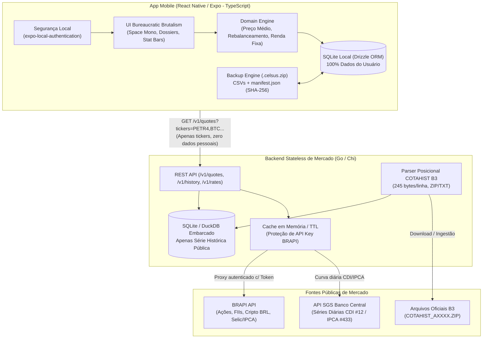
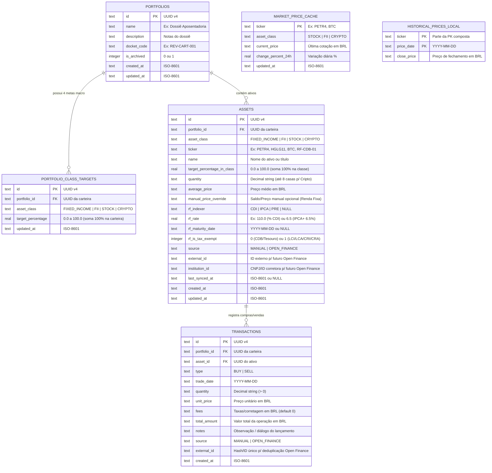
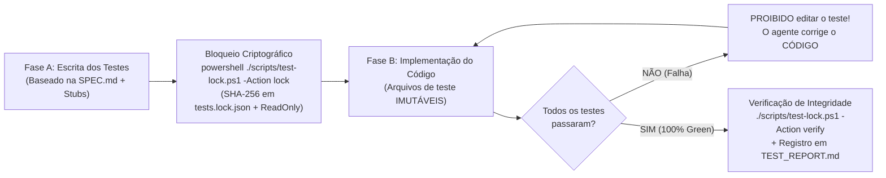

# CELSUS — Especificação Técnica, Arquitetura e Plano de Sprints (MVP)

> **DOCKET REF:** `CELSUS-SPEC-MVP-001`  
> **Arquitetura:** Mobile Local-First (`React Native / Expo` + `SQLite`) + Market Data Engine Stateless (`Go`)  
> **Privacidade:** 100% dos dados pessoais, carteiras e aportes armazenados exclusivamente no dispositivo do usuário.  
> **Estética:** *Bureaucratic Brutalism & Painterly Skeuomorphism* ([DESIGN_SYSTEM.md](file:///c:/Users/Pedro/Documents/Projetos/Celsus/DESIGN_SYSTEM.md))

---

## 1. Visão Geral do Produto

O **Celsus** é um gestor de carteiras de investimentos mobile focado em privacidade absoluta (**100% Local-First**), alocação inteligente por metas em dois níveis e estética autoral inspirada em dossiês burocráticos e pintura expressionista (*Space Mono*, papéis envelhecidos `#D5CAA8`, carvão `#111315`, verde oxidado `#2E4A44` e âmbar `#D96628`).

### Escopo do MVP
1. **Múltiplas Carteiras Independentes + Visão Consolidada:** Cada carteira possui seus próprios ativos, metas de peso e histórico de transações, além de um Dossiê Consolidado na tela inicial que soma todo o patrimônio em BRL (`R$`).
2. **4 Classes de Ativos Suportadas:**
   - **Renda Fixa** (`FIXED_INCOME`) — Atributo visual: *Intellect* (`#2E4A44`)
   - **Fundos Imobiliários / FIIs** (`FII`) — Atributo visual: *Psyche* (`#D5CAA8`)
   - **Ações** (`STOCK`) — Atributo visual: *Physique* (`#D96628`)
   - **Criptomoedas** (`CRYPTO`) — Atributo visual: *Motorics* (`#C49A45`)
3. **Pesos em 2 Níveis + Calculadora de Novo Aporte:**
   - **Nível Macro:** Meta percentual (0–100%) para cada classe de ativo dentro da carteira.
   - **Nível Micro:** Meta percentual (0–100%) para cada ativo dentro de sua classe.
   - **Simulador de Aporte:** Ao informar um valor em `R$`, o app distribui o aporte proporcionalmente entre os ativos mais descontados em relação à meta global (sem sugerir vendas).
4. **Motor de Cotações Híbrido (COTAHIST B3 + BRAPI + Indexadores):**
   - Carga histórica inicial de Ações e FIIs processada pelo backend em **Go** a partir dos arquivos oficiais **COTAHIST** da B3.
   - Cotações recentes/atuais de Ações, FIIs e Criptomoedas (em BRL) via **BRAPI**.
   - Cálculo automático de saldo bruto em **Renda Fixa** (CDI, IPCA+, Pré-fixado) via séries históricas de taxas + opção de ajuste manual de saldo.
5. **Movimentações (Compras/Aportes e Vendas/Resgates):**
   - Cálculo automático de **Preço Médio** e **Quantidade Atual**, com preenchimento automático do preço histórico na data da operação via COTAHIST/BRAPI.
   - Estrutura de banco já preparada para vínculo futuro com **Open Finance** (`source`, `external_id`, `institution_id`, `last_synced_at`).
6. **Backup e Recuperação Offline (`.celsus.zip`):**
   - Exportação e importação em arquivo `.zip` contendo CSVs legíveis (`portfolios.csv`, `class_targets.csv`, `assets.csv`, `transactions.csv`) + `manifest.json` com hashes `SHA-256` para validação de integridade, suportando **Restore Completo** ou **Mesclagem por UUID**.
7. **Segurança Local:**
   - Modo Privacidade (ocultar valores em `R$`) e bloqueio por Biometria/PIN nativo (`expo-local-authentication`).

---

## 2. Arquitetura do Sistema



> [!IMPORTANT]
> **Garantia de Privacidade 100% Local:** O servidor Go **nunca** recebe IDs de carteiras, quantidades de ativos, valores aportados ou identificadores pessoais. O celular envia apenas uma lista de tickers públicos (ex.: `GET /v1/quotes?tickers=PETR4,HGLG11,BTC`) para atualizar seu cache local de preços.

---

## 3. Stack Tecnológica Definida

### 3.1. App Mobile (`apps/mobile`)
- **Framework:** React Native com **Expo SDK 52+** (Expo Router v4 para navegação file-based).
- **Linguagem:** TypeScript (strict mode).
- **Banco de Dados Local:** `expo-sqlite` (API síncrona moderna `openDatabaseSync`) + **Drizzle ORM** (`drizzle-orm/expo-sqlite`) e migrations embarcadas.
- **Gerenciamento de Estado & Cache:** `Zustand` (estado global de UI, carteira ativa, modo privacidade) + `@tanstack/react-query` (sincronização de cotações com o backend Go).
- **Estilização & Fontes:** `NativeWind v4` (Tailwind CSS configurado com os tokens exatos do [DESIGN_SYSTEM.md](file:///c:/Users/Pedro/Documents/Projetos/Celsus/DESIGN_SYSTEM.md)) + `@expo-google-fonts/space-mono`.
- **Gráficos:** `react-native-wagmi-charts` ou `victory-native` (Skia) estilizados com linhas retas, cores `#D96628`, `#2E4A44`, `#D5CAA8` e fundo `#191B1D`.
- **Manipulação de Arquivos e ZIP:** `expo-file-system`, `expo-sharing`, `expo-document-picker`, `fflate` (compactação/descompactação ZIP pura em JS ultra-rápida), `expo-crypto` (hash SHA-256 do `manifest.json`).
- **Precisão Decimal:** `decimal.js` para evitar erros de ponto flutuante em cálculos financeiros e quantidades de criptomoedas (8 casas decimais).

### 3.2. Backend de Dados de Mercado (`services/market-api`)
- **Linguagem:** **Go 1.23+**
- **Router HTTP:** `go-chi/chi/v5` (leve, idiomático, zero dependências pesadas).
- **Banco de Série Histórica Pública:** `SQLite` embarcado (`modernc.org/sqlite` CGO-free) com índices compostos `(ticker, trade_date)` em modo `WAL`.
- **Módulos Internos:**
  - `internal/cotahist`: Leitor streaming de arquivos `.ZIP`/`.TXT` posicionais de 245 bytes da B3 (ISO-8859-1 -> UTF-8) com inserção em batch transacional.
  - `internal/brapi`: Cliente HTTP para BRAPI (`/api/quote`, `/api/v2/crypto`) com cache TTL (ex.: 5–15 min no pregão) e *singleflight* (evita chamadas duplicadas simultâneas).
  - `internal/macro`: Sincronizador das séries históricas do CDI diário e IPCA mensal/diário (via BRAPI / BCB SGS) para alimentar o motor de Renda Fixa.

---

## 4. Modelagem do Banco de Dados Local (Mobile SQLite)

Todas as chaves primárias utilizam **UUID v4** para permitir exportação/importação e mesclagem sem colisão de IDs. Valores monetários e quantidades são salvos como texto decimal ou inteiros em escala fixa, operados via `decimal.js`.

### 4.1. Diagrama Entidade-Relacionamento (Local SQLite)



---

## 5. Regras de Negócio e Fórmulas Financeiras

### 5.1. Sistema de Pesos em 2 Níveis (Alocação Ideal)
1. **Peso Macro da Classe ($W_{\text{classe}}$):**
   Em cada carteira, a soma das 4 classes (`FIXED_INCOME`, `FII`, `STOCK`, `CRYPTO`) deve totalizar $100\%$:
   $$\sum_{c \in \text{Classes}} W_c = 100\%$$
2. **Peso Micro do Ativo na Classe ($w_{i,c}$):**
   Dentro de uma classe $c$ que possui $W_c > 0$, a soma dos pesos dos ativos cadastrados naquela classe deve totalizar $100\%$:
   $$\sum_{i \in c} w_{i,c} = 100\%$$
3. **Peso Global Ideal do Ativo na Carteira ($T_i$):**
   $$T_i = \frac{W_c \times w_{i,c}}{100}$$
   *(Exemplo: Se Ações tem meta de $40\%$ na carteira e `WEGE3` tem meta de $25\%$ dentro de Ações, a meta global de `WEGE3` na carteira é $10\%$).*

---

### 5.2. Algoritmo da Calculadora Inteligente de Novo Aporte
Quando o usuário deseja fazer um novo aporte de valor $A > 0$ (em `R$`) em uma carteira cujo patrimônio atual é $V_{\text{atual}}$:

1. **Patrimônio Projetado Pós-Aporte ($V_{\text{final}}$):**
   $$V_{\text{final}} = V_{\text{atual}} + A$$
2. **Valor Ideal Pós-Aporte de cada Ativo ($V^{\text{meta}}_i$):**
   $$V^{\text{meta}}_i = V_{\text{final}} \times \left(\frac{T_i}{100}\right)$$
3. **Déficit Financeiro Positivo de cada Ativo ($D_i$):**
   Como o rebalanceamento por aporte **não realiza vendas**, ativos que já estão acima da meta recebem déficit zero:
   $$D_i = \max\left(0,\; V^{\text{meta}}_i - V_{\text{atual}, i}\right)$$
4. **Aporte Sugerido para o Ativo ($\Delta A_i$):**
   $$S_D = \sum_{j} D_j$$
   $$\Delta A_i = A \times \left(\frac{D_i}{S_D}\right)$$
5. **Conversão em Quantidade Sugerida ($Q^{\text{sug}}_i$):**
   - Para **Ações e FIIs**: arredonda para número inteiro de cotas ($\lfloor \Delta A_i / P_i \rfloor$) e redistribui o troco residual para o ativo elegível de menor preço unitário, ou exibe o valor exato de sobra em caixa.
   - Para **Criptomoedas**: calcula com até 8 casas decimais ($\Delta A_i / P_i$).
   - Para **Renda Fixa**: sugere o valor financeiro exato em `R$` ($\Delta A_i$).

---

### 5.3. Cálculo de Preço Médio (PM) e Posição
- **Na Compra (`BUY`):**
  $$\text{Custo Total Novo} = (Q_{\text{anterior}} \times PM_{\text{anterior}}) + (Q_{\text{compra}} \times P_{\text{compra}}) + \text{Taxas}$$
  $$Q_{\text{nova}} = Q_{\text{anterior}} + Q_{\text{compra}}$$
  $$PM_{\text{novo}} = \frac{\text{Custo Total Novo}}{Q_{\text{nova}}}$$
- **Na Venda (`SELL`):**
  A venda **não altera** o Preço Médio ($PM_{\text{novo}} = PM_{\text{anterior}}$); ela apenas reduz a quantidade em carteira ($Q_{\text{nova}} = Q_{\text{anterior}} - Q_{\text{venda}}$) e apura o lucro/prejuízo realizado da operação:
  $$\text{Resultado Realizado} = (Q_{\text{venda}} \times P_{\text{venda}} - \text{Taxas}) - (Q_{\text{venda}} \times PM_{\text{anterior}})$$
  Se $Q_{\text{nova}} = 0$, o Preço Médio é zerado ($0.00$), mas o ativo permanece na carteira caso seu peso meta seja $> 0\%$.

---

### 5.4. Precificação de Renda Fixa (Motor Local + Curvas Macro)
Cada título de Renda Fixa pode ter seu saldo atual obtido de duas maneiras:
1. **Cálculo Automático por Indexador (Padrão):**
   Para cada aporte $k$ de valor $C_k$ realizado na data $d_k$ até hoje ($d_{\text{hoje}}$):
   - **Pós-fixado `% do CDI` (ex.: `110% do CDI`):**
     $$\text{Fator}_{k} = \prod_{t = d_k}^{d_{\text{hoje}}} \left(1 + \text{CDI}_{\text{diário}}(t) \times \frac{\text{Taxa}}{100}\right)$$
   - **Pré-fixado (ex.: `12.5% a.a.`):**
     $$\text{Fator}_{k} = \left(1 + \frac{\text{Taxa}}{100}\right)^{\frac{\text{Dias Úteis}(d_k, d_{\text{hoje}})}{252}}$$
   - **Híbrido `IPCA + Taxa% a.a.`:**
     Combina a variação acumulada do IPCA no período com o cupom pré-fixado pro-rata em dias úteis (base 252).
2. **Override Manual (`manual_price_override`):**
   Caso o usuário queira cravar o valor exato exibido no app da corretora, pode informar o "Saldo Atual Manual", que tem precedência sobre a curva teórica até ser limpo ou atualizado.

---

## 6. Especificação do Backend Go (`services/market-api`)

### 6.1. Layout do Parser Posicional COTAHIST (B3)
O arquivo `COTAHIST_AXXXX.TXT` possui registros de **245 bytes** por linha. O parser Go deve filtrar apenas linhas com `TIPREG == "01"` (Cotações) e:
- `TPMERC` (posições 025–027): `"010"` (Vista) e `"020"` (Fracionário, opcional).
- `CODBDI` (posições 011–012): `"02"` (Lote Padrão / Ações) e `"12"` (Fundos Imobiliários / FIIs).

| Campo | Posição (1-based) | Slice Go (0-based) | Tipo | Descrição |
| :--- | :---: | :---: | :---: | :--- |
| `TIPREG` | 001–002 | `line[0:2]` | `string` | Fixo `"01"` para cotações |
| `DATPRE` | 003–010 | `line[2:10]` | `YYYYMMDD` | Data do pregão |
| `CODBDI` | 011–012 | `line[10:12]` | `string` | `"02"` = Ações, `"12"` = FIIs |
| `CODNEG` | 013–024 | `line[12:24]` | `string` | Ticker (`strings.TrimSpace`) |
| `TPMERC` | 025–027 | `line[24:27]` | `string` | `"010"` = Mercado à Vista |
| `NOMRES` | 028–039 | `line[27:39]` | `string` | Nome resumido da empresa/fundo |
| `PREABE` | 057–069 | `line[56:69]` | `int64 / 100` | Preço de abertura (2 casas implícitas) |
| `PREMAX` | 070–082 | `line[69:82]` | `int64 / 100` | Preço máximo |
| `PREMIN` | 083–095 | `line[82:95]` | `int64 / 100` | Preço mínimo |
| `PREULT` | 109–121 | `line[108:121]` | `int64 / 100` | **Preço de fechamento** |
| `VOLTOT` | 171–188 | `line[170:188]` | `int64 / 100` | Volume financeiro total |

### 6.2. Endpoints REST do Backend Go
1. `GET /v1/health`
   - Retorna status do servidor, última data do COTAHIST carregada no banco e status da conexão BRAPI.
2. `GET /v1/catalog/search?q=PETR&class=STOCK`
   - Busca rápida por ticker ou nome da empresa/FII/Cripto para autocomplete no celular.
3. `GET /v1/quotes?tickers=PETR4,HGLG11,BTC`
   - Retorna cotação atual em BRL, variação 24h e timestamp. Consulta o cache local; se expirado, busca em lote na BRAPI (`/api/quote/` para B3 e `/api/v2/crypto?coin=BTC&currency=BRL` para cripto).
4. `GET /v1/history?tickers=PETR4,HGLG11&from=2023-01-01&to=2026-10-30`
   - Retorna série histórica de fechamento diário combinando a base do **COTAHIST** (passado) + **BRAPI** (dias recentes ainda não consolidados no arquivo anual).
5. `GET /v1/rates/macro?from=2021-01-01`
   - Retorna série compacta de taxas diárias do **CDI**, **Selic** e **IPCA** para o motor de Renda Fixa do app mobile calcular a evolução dos títulos offline.
6. `POST /v1/admin/cotahist/sync` (ou comando CLI `market-api sync-cotahist --years 5`)
   - Baixa e ingere os arquivos `COTAHIST_A{ANO}.ZIP` diretamente da B3 de forma idempotente (`INSERT OR REPLACE`).

---

## 7. Especificação do Arquivo de Backup (`.celsus.zip`)

O arquivo exportado pelo app recebe o nome padrão `celsus-dossier-YYYYMMDD-HHMM.celsus.zip` e contém exatamente 5 arquivos na raiz:

```text
celsus-dossier-20261030-2330.celsus.zip
├── manifest.json
├── portfolios.csv
├── class_targets.csv
├── assets.csv
└── transactions.csv
```

### 7.1. Estrutura do `manifest.json`
```json
{
  "format": "CELSUS_ARCHIVE",
  "schemaVersion": 1,
  "appVersion": "0.1.0",
  "exportedAt": "2026-10-30T23:30:00-03:00",
  "currency": "BRL",
  "files": {
    "portfolios.csv": {
      "rows": 2,
      "sha256": "e3b0c44298fc1c149afbf4c8996fb92427ae41e4649b934ca495991b7852b855"
    },
    "class_targets.csv": {
      "rows": 8,
      "sha256": "..."
    },
    "assets.csv": {
      "rows": 14,
      "sha256": "..."
    },
    "transactions.csv": {
      "rows": 65,
      "sha256": "..."
    }
  }
}
```

### 7.2. Regras de Validação na Importação
1. Descompacta o `.zip` em memória/diretório temporário.
2. Valida existência e sintaxe do `manifest.json` e compatibilidade de `schemaVersion`.
3. Calcula o `SHA-256` de cada `.csv` extraído e compara com o hash declarado em `manifest.json`. Se qualquer hash divergir, aborta a importação antes de tocar no SQLite local e exibe um alerta de integridade (`[SECURITY PROTOCOL: CORRUPTED DOSSIER]`).
4. Executa a importação dentro de uma **única transação SQLite (`BEGIN TRANSACTION ... COMMIT`)**:
   - **Modo Substituir Tudo (Restore):** Limpa as tabelas locais e insere todos os registros do backup.
   - **Modo Mesclar (Merge):** Faz `UPSERT` por `id` (UUID v4) nas carteiras, ativos e transações, recalculando ao final o Preço Médio e Quantidade de cada ativo a partir de suas transações.

---

## 8. Mapa de Telas e UX (Bureaucratic Brutalism)

Seguindo rigorosamente o [DESIGN_SYSTEM.md](file:///c:/Users/Pedro/Documents/Projetos/Celsus/DESIGN_SYSTEM.md):

1. **Dossiê Geral (Home / Consolidado):**
   - Cabeçalho tipo carimbo datilografado (`DOCKET REF: REV-PATRIMÔNIO-GERAL`) + botão de Modo Privacidade (`[EYE: REDACTED]`) e status de sincronização.
   - Card principal em *Parchment Inset* (`#D5CAA8` com texto `#191B1D` em `Space Mono` `tnum`) mostrando **Patrimônio Bruto Total (R$)**, **Valor Investido (R$)** e **Lucro/Prejuízo Acumulado (R$ e %)**.
   - **Gráfico de Evolução Patrimonial:** Duas linhas angulares (Patrimônio de Mercado em `#2E4A44` vs Custo Aportado em `#D5CAA8` tracejado) usando a série histórica do COTAHIST + CDI.
   - **Lista de Carteiras (*Thought Cabinet Hexagon Specimen Cards*):** Cards com cantos chanfrados em 45°, mostrando código do dossiê, saldo atual, rentabilidade e barra de aderência à meta.
2. **Dossiê da Carteira (Detalhes da Carteira):**
   - **As 4 Barras Psicológicas de Atributos (Alocação Macro Atual vs Meta):**
     - `INTELLECT` (`#2E4A44`) — **Renda Fixa:** `[||||||....] 32.0% / META 30.0%`
     - `PSYCHE` (`#D5CAA8`) — **FIIs:** `[|||||.....] 24.5% / META 25.0%`
     - `PHYSIQUE` (`#D96628`) — **Ações:** `[|||||||...] 33.5% / META 35.0%`
     - `MOTORICS` (`#C49A45`) — **Criptomoedas:** `[||........] 10.0% / META 10.0%`
   - Aba de **Ativos por Classe** (mostrando Preço Médio, Preço Atual, `% na Classe` vs `Meta na Classe`, `% na Carteira` vs `Meta Global`).
   - Botão primário âmbar (`#D96628`, sombra sólida `2px 2px 0px #000`): **`[SIMULAR NOVO APORTE]`**.
3. **Simulador de Aporte & Rebalanceamento:**
   - Input sublinhado estilo livro-razão (`R$ ______`) com cursor piscante.
   - Gera o relatório estilo diálogo:
     - `"[LOGIC: EQUILIBRIUM] WEGE3 está 3.4% abaixo da meta ideal. Direcionar R$ 450,00 (11 cotas)."`
   - Botão para converter a sugestão diretamente em lançamentos de compra (`BUY`) com 1 toque.
4. **Livro-Razão de Movimentações (*Dialogue-Tree Ledger Entries*):**
   - Histórico cronológico de Compras (`+`) e Vendas (`-`) conectados por linhas verticais pontilhadas em `#2E4A44`.
   - Ao lançar um aporte em data passada para uma Ação/FII, o app consulta a cotação histórica daquela data no backend Go (COTAHIST) e já preenche o preço unitário sugerido.
5. **Arquivo Morto & Segurança (Configurações / Backup):**
   - Exportar Dossiê (`.celsus.zip`), Importar Dossiê (Restore ou Merge), chave de Biometria/PIN e configuração da URL do servidor Go.

---

## 9. Protocolo de TDD Estrito com Testes Imutáveis (`TDD Lock`)

Para garantir fidelidade matemática e impedir que o agente codificador altere testes para forçar aprovações ("test gaming"), todo o desenvolvimento segue o protocolo **TDD Lock** imposto pela regra [`.agents/rules/tdd-lock.md`](file:///c:/Users/Pedro/Documents/Projetos/Celsus/.agents/rules/tdd-lock.md) e pelo script [`scripts/test-lock.ps1`](file:///c:/Users/Pedro/Documents/Projetos/Celsus/scripts/test-lock.ps1):



### Regras de Governança TDD
1. **Fase A (Red & Lock):** Os testes automatizados da Sprint são criados primeiro, junto apenas com as assinaturas/interfaces vazias necessárias para compilação. Em seguida, roda-se `./scripts/test-lock.ps1 -Action lock`, que grava o hash `SHA-256` de cada arquivo de teste em `tests.lock.json` e aplica permissão `ReadOnly` no sistema operacional.
2. **Fase B (Green & Verify):** O agente implementa o código de produção até todos os testes passarem. Se um teste falhar, **o agente retorna ao código de produção e o corrige — nunca altera o teste**.
3. **Auditoria e Relatório ([`TEST_REPORT.md`](file:///c:/Users/Pedro/Documents/Projetos/Celsus/TEST_REPORT.md)):** Ao final de cada Sprint, o comando `./scripts/test-lock.ps1 -Action verify` comprova que nenhum hash `SHA-256` de teste foi modificado, e os resultados detalhados são gravados em [`TEST_REPORT.md`](file:///c:/Users/Pedro/Documents/Projetos/Celsus/TEST_REPORT.md).

---

## 10. Divisão de Sprints e Prompts de Execução (Fase A + Fase B)

O projeto está dividido em **6 Sprints incrementais**, cada uma com um prompt para a **Fase A (Criar e Bloquear Testes)** e um prompt para a **Fase B (Implementar Código e Gerar Relatório)**.

---

### SPRINT 1: Backend Go — Motor COTAHIST B3, Proxy BRAPI e Curvas Macro
**Objetivo:** Construir o servidor stateless em Go (`services/market-api`) capaz de baixar/processar arquivos COTAHIST da B3, buscar cotações atuais de Ações/FIIs/Cripto na BRAPI com cache e servir a curva diária de CDI/IPCA.

#### Prompt da Sprint 1 — Fase A (Criar Testes + Bloquear)
```markdown
Vamos executar a **Sprint 1 — Fase A (TDD: Especificação e Bloqueio de Testes)** conforme definido em `SPEC.md` e `TEST_REPORT.md`.

1. Inicialize o módulo Go em `services/market-api` (`github.com/pedro/celsus/services/market-api`) e crie apenas as structs, interfaces e assinaturas de funções vazias (stubs) para os pacotes `internal/cotahist`, `internal/brapi`, `internal/macro` e `internal/http`.
2. Escreva toda a suíte de testes unitários e de contrato (`S1-T01` a `S1-T09` listados em `TEST_REPORT.md`):
   - `internal/cotahist/parser_test.go`: parsing de linhas de 245 bytes (`TIPREG=01`, `CODBDI=02/12`, `TPMERC=010`), conversão de centavos (`int64/100`), descarte de header/trailer/opções e leitura de `.ZIP`.
   - `internal/cotahist/repository_test.go`: upsert idempotente em SQLite sem duplicar cotações.
   - `internal/brapi/client_test.go`: busca em lote de Ações/FIIs, Cripto em BRL e funcionamento do cache TTL.
   - `internal/macro/rates_test.go`: persistência e consulta das curvas diárias de CDI e IPCA.
   - `internal/http/handlers_test.go`: testes dos 5 endpoints REST (`/v1/health`, `/v1/catalog/search`, `/v1/quotes`, `/v1/history`, `/v1/rates/macro`).
3. Execute `powershell -ExecutionPolicy Bypass -File ./scripts/test-lock.ps1 -Action lock` para bloquear todos os testes com `ReadOnly` e registrar os hashes `SHA-256` em `tests.lock.json`.
4. Atualize a tabela da Sprint 1 em `TEST_REPORT.md` com os hashes `SHA-256` gerados. Não implemente a lógica de produção ainda.
```

#### Prompt da Sprint 1 — Fase B (Implementar Código sob Bloqueio + Relatório)
```markdown
Vamos executar a **Sprint 1 — Fase B (Implementação TDD sob Bloqueio)** conforme definido em `SPEC.md`.

REGRAS OBRIGATÓRIAS:
- Você está PROIBIDO de alterar qualquer arquivo `*_test.go` ou `tests.lock.json`.
- Se algum teste falhar, corrija exclusivamente o código de produção em `services/market-api`.

Passos:
1. Implemente o schema SQLite (`modernc.org/sqlite`) em modo WAL e a lógica completa dos pacotes `internal/cotahist`, `internal/brapi`, `internal/macro` e `internal/http`.
2. Rode `go test ./... -v` repetidamente, ajustando a implementação até que 100% dos testes (`S1-T01` a `S1-T09`) passem.
3. Rode `powershell -ExecutionPolicy Bypass -File ./scripts/test-lock.ps1 -Action verify` para comprovar que nenhum arquivo de teste foi modificado.
4. Atualize `TEST_REPORT.md` com o status `PASS`, tempo de execução e log de saída dos testes da Sprint 1.
```

---

### SPRINT 2: Fundação Mobile Expo, Design System "Celsus" e Banco Local (SQLite + Drizzle)
**Objetivo:** Criar o app React Native (Expo) em `apps/mobile`, configurar os tokens visuais e componentes do `DESIGN_SYSTEM.md` (*Bureaucratic Brutalism*, fonte `Space Mono`) e estruturar o banco local SQLite com Drizzle ORM.

#### Prompt da Sprint 2 — Fase A (Criar Testes + Bloquear)
```markdown
Vamos executar a **Sprint 2 — Fase A (TDD: Especificação e Bloqueio de Testes)** conforme definido em `SPEC.md`, `DESIGN_SYSTEM.md` e `TEST_REPORT.md`.

1. Inicialize o projeto Expo com TypeScript e Jest (`jest-expo`) em `apps/mobile` e crie apenas os arquivos de tipos e stubs vazios de tema, componentes e schema do banco.
2. Desbloqueie o lock anterior com `powershell -ExecutionPolicy Bypass -File ./scripts/test-lock.ps1 -Action unlock`, escreva todos os testes da Sprint 2 (`S2-T01` a `S2-T03` de `TEST_REPORT.md`):
   - `src/theme/__tests__/tokens.test.ts`: validação de todos os tokens hexadecimais (`#111315`, `#191B1D`, `#D96628`, `#2E4A44`, `#D5CAA8`, etc.) e tipografia `Space Mono`.
   - `src/components/ui/__tests__/AttributeStatBar.test.tsx`: mapeamento das 4 classes (`FIXED_INCOME` -> Intellect, `FII` -> Psyche, `STOCK` -> Physique, `CRYPTO` -> Motorics) e renderização de `% Atual vs % Meta`.
   - `src/db/__tests__/schema.test.ts`: validação das 6 tabelas SQLite/Drizzle (`portfolios`, `portfolio_class_targets`, `assets`, `transactions`, `market_price_cache`, `historical_prices_local`) incluindo as colunas de Open Finance (`source`, `external_id`, `institution_id`, `last_synced_at`).
3. Bloqueie novamente todos os testes rodando `powershell -ExecutionPolicy Bypass -File ./scripts/test-lock.ps1 -Action lock` e registre os hashes `SHA-256` em `TEST_REPORT.md`.
```

#### Prompt da Sprint 2 — Fase B (Implementar Código sob Bloqueio + Relatório)
```markdown
Vamos executar a **Sprint 2 — Fase B (Implementação TDD sob Bloqueio)** conforme definido em `SPEC.md` e `DESIGN_SYSTEM.md`.

REGRAS OBRIGATÓRIAS:
- Você está PROIBIDO de alterar qualquer arquivo de teste (`*.test.ts`, `*.test.tsx`). Se um teste falhar, ajuste o código de produção.

Passos:
1. Implemente os tokens do Design System, os componentes base (`DossierCard`, `AttributeStatBar`, `DirectiveButton`, `LedgerInput`, `SpecimenHexCard`) e o schema/migrations do `expo-sqlite` + `drizzle-orm`.
2. Execute `npm test` em `apps/mobile` e corrija o código de produção até 100% dos testes passarem.
3. Execute `powershell -ExecutionPolicy Bypass -File ./scripts/test-lock.ps1 -Action verify` e registre os resultados em `TEST_REPORT.md`.
```

---

### SPRINT 3: Gestão de Carteiras, Pesos em 2 Níveis e Motor Financeiro
**Objetivo:** Implementar o CRUD completo de múltiplas carteiras, a configuração das metas Macro (por classe) e Micro (por ativo) e o motor de cálculo de posição, preço médio, curva de Renda Fixa e rebalanceamento.

#### Prompt da Sprint 3 — Fase A (Criar Testes + Bloquear)
```markdown
Vamos executar a **Sprint 3 — Fase A (TDD: Especificação e Bloqueio de Testes)** conforme definido em `SPEC.md` e `TEST_REPORT.md`.

1. Desbloqueie o lock (`./scripts/test-lock.ps1 -Action unlock`) e crie apenas as assinaturas/interfaces vazias em `apps/mobile/src/domain/finance/`.
2. Escreva todos os testes matemáticos da Sprint 3 (`S3-T01` a `S3-T08` de `TEST_REPORT.md`) seguindo exatamente as fórmulas da Seção 5 da `SPEC.md`:
   - `weights.test.ts`: cálculo do peso global $T_i = (W_c \times w_{i,c}) / 100$ e validações de soma 100%.
   - `averagePrice.test.ts`: compras sucessivas com taxas, manutenção do PM em vendas parciais, zeramento de posição e precisão de 8 casas decimais para Cripto.
   - `fixedIncome.test.ts`: capitalização diária pós-fixada (% CDI), Pré-fixada (base 252), IPCA+ e precedência de `manual_price_override`.
   - `rebalance.test.ts`: Calculadora Inteligente de Novo Aporte ($D_i = \max(0, V^{\text{meta}}_i - V_{\text{atual},i})$) garantindo zero sugestão de venda, cotas inteiras para Ações/FIIs e frações de 8 casas para Cripto.
3. Bloqueie os testes (`./scripts/test-lock.ps1 -Action lock`) e atualize os hashes `SHA-256` em `TEST_REPORT.md`.
```

#### Prompt da Sprint 3 — Fase B (Implementar Código sob Bloqueio + Relatório)
```markdown
Vamos executar a **Sprint 3 — Fase B (Implementação TDD sob Bloqueio)** conforme definido em `SPEC.md`.

REGRAS OBRIGATÓRIAS:
- Não altere nenhum arquivo de teste. Se um teste falhar, ajuste a implementação em `src/domain/finance/` ou nos repositórios.

Passos:
1. Implemente todas as funções do motor financeiro com `decimal.js`, os repositórios SQLite e as telas de Gestão de Carteiras e Ativos (com pesos em 2 níveis).
2. Rode a suíte de testes até atingir 100% de aprovação.
3. Valide a integridade com `./scripts/test-lock.ps1 -Action verify` e atualize `TEST_REPORT.md`.
```

---

### SPRINT 4: Aportes Manuais, Vendas, Integração COTAHIST/BRAPI e Simulador de Aporte
**Objetivo:** Implementar o lançamento de movimentações (`BUY`/`SELL`) com preenchimento automático de preço histórico via COTAHIST, sincronização de cotações atuais via BRAPI e a tela interativa da Calculadora de Novo Aporte.

#### Prompt da Sprint 4 — Fase A (Criar Testes + Bloquear)
```markdown
Vamos executar a **Sprint 4 — Fase A (TDD: Especificação e Bloqueio de Testes)** conforme definido em `SPEC.md` e `TEST_REPORT.md`.

1. Desbloqueie o lock (`./scripts/test-lock.ps1 -Action unlock`) e crie as assinaturas dos serviços `marketApi.ts`, `transactionService.ts` e `rebalanceExecution.ts`.
2. Escreva os testes `S4-T01` a `S4-T03`:
   - Pré-preenchimento automático do preço unitário na data da operação a partir do histórico COTAHIST.
   - Persistência transacional de compra/venda atualizando atomicamente quantidade e preço médio do ativo.
   - Conversão em lote das sugestões do Simulador de Aporte em lançamentos `BUY` no Livro-Razão.
3. Bloqueie os testes (`./scripts/test-lock.ps1 -Action lock`) e registre os hashes `SHA-256` em `TEST_REPORT.md`.
```

#### Prompt da Sprint 4 — Fase B (Implementar Código sob Bloqueio + Relatório)
```markdown
Vamos executar a **Sprint 4 — Fase B (Implementação TDD sob Bloqueio)** conforme definido em `SPEC.md` e `DESIGN_SYSTEM.md`.

REGRAS OBRIGATÓRIAS:
- Não edite nenhum arquivo de teste bloqueado.

Passos:
1. Implemente os serviços `marketApi.ts`, `transactionService.ts`, `rebalanceExecution.ts`, a tela de Nova Movimentação, a árvore de transações (`Dialogue-Tree Ledger Entries`) e a tela do Simulador de Novo Aporte.
2. Rode os testes até 100% passarem, valide com `./scripts/test-lock.ps1 -Action verify` e atualize `TEST_REPORT.md`.
```

---

### SPRINT 5: Dashboards (Consolidado e por Carteira) e Gráficos de Evolução Patrimonial
**Objetivo:** Construir os gráficos de Alocação (Atual vs Meta) e de Evolução Patrimonial histórica (usando a série COTAHIST + CDI cruzada com o histórico de aportes).

#### Prompt da Sprint 5 — Fase A (Criar Testes + Bloquear)
```markdown
Vamos executar a **Sprint 5 — Fase A (TDD: Especificação e Bloqueio de Testes)** conforme definido em `SPEC.md` e `TEST_REPORT.md`.

1. Desbloqueie o lock (`./scripts/test-lock.ps1 -Action unlock`) e crie as assinaturas de `portfolioHistory.ts` e `consolidatedView.ts`.
2. Escreva os testes `S5-T01` e `S5-T02`:
   - Reconstrução exata da curva histórica `investedCapital` vs `marketValue` cruzando aportes/vendas com preços do COTAHIST e curva de Renda Fixa.
   - Consolidação precisa de múltiplas carteiras independentes no Dossiê Geral (Home).
3. Bloqueie os testes (`./scripts/test-lock.ps1 -Action lock`) e documente os hashes `SHA-256` em `TEST_REPORT.md`.
```

#### Prompt da Sprint 5 — Fase B (Implementar Código sob Bloqueio + Relatório)
```markdown
Vamos executar a **Sprint 5 — Fase B (Implementação TDD sob Bloqueio)** conforme definido em `SPEC.md` e `DESIGN_SYSTEM.md`.

REGRAS OBRIGATÓRIAS:
- Não edite nenhum arquivo de teste bloqueado.

Passos:
1. Implemente `portfolioHistory.ts`, `consolidatedView.ts` e as telas do Dossiê Consolidado (Home), Detalhes da Carteira e Detalhe do Ativo com os gráficos de Evolução Patrimonial e Alocação.
2. Rode todos os testes até 100% passarem, valide com `./scripts/test-lock.ps1 -Action verify` e atualize `TEST_REPORT.md`.
```

---

### SPRINT 6: Exportação/Importação (`.celsus.zip` com CSVs + SHA-256) e Segurança Local
**Objetivo:** Implementar o sistema completo de Backup e Restauração via arquivo `.celsus.zip` (CSVs + `manifest.json` com verificação de integridade SHA-256), Modo Privacidade e Bloqueio Biométrico.

#### Prompt da Sprint 6 — Fase A (Criar Testes + Bloquear)
```markdown
Vamos executar a **Sprint 6 — Fase A (TDD: Especificação e Bloqueio de Testes)** conforme definido em `SPEC.md` e `TEST_REPORT.md`.

1. Desbloqueie o lock (`./scripts/test-lock.ps1 -Action unlock`) e crie as assinaturas de `backupService.ts` e `privacyAndAuth.ts`.
2. Escreva os testes `S6-T01` a `S6-T04`:
   - Geração do pacote `.celsus.zip` contendo `manifest.json` + 4 arquivos CSV com hashes `SHA-256` e contagem de linhas exatos.
   - Rejeição imediata de arquivo `.celsus.zip` quando qualquer byte de um CSV for adulterado (divergência de `SHA-256`), mantendo o banco local intacto.
   - Restauração completa (*Restore*) e mesclagem sem duplicação (*Merge por UUID v4*).
   - Redação de valores em Modo Privacidade (`██████,██`) e acionamento do bloqueio biométrico.
3. Bloqueie todos os testes (`./scripts/test-lock.ps1 -Action lock`) e atualize os hashes `SHA-256` em `TEST_REPORT.md`.
```

#### Prompt da Sprint 6 — Fase B (Implementar Código sob Bloqueio + Relatório)
```markdown
Vamos executar a **Sprint 6 — Fase B (Implementação TDD sob Bloqueio)** conforme definido em `SPEC.md` e `DESIGN_SYSTEM.md`.

REGRAS OBRIGATÓRIAS:
- Não edite nenhum arquivo de teste bloqueado.

Passos:
1. Implemente `backupService.ts`, `privacyAndAuth.ts` e a tela de Configurações / Arquivo Morto.
2. Rode toda a suíte de testes do projeto (Go + Mobile) até atingir 100% de aprovação.
3. Execute `powershell -ExecutionPolicy Bypass -File ./scripts/test-lock.ps1 -Action verify` e consolide o relatório final em `TEST_REPORT.md`.
```
