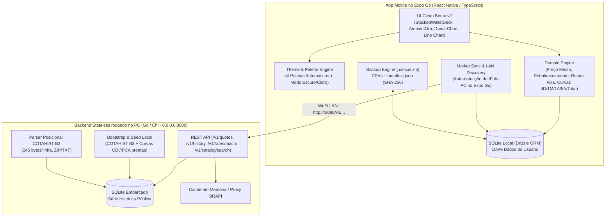

# CELSUS — SPEC v2 (Especificação Completa: MVP Sprints 1–6 + Aperfeiçoamento Geral Sprints 7–11 + Ajustes Finos Sprints 12–14)

> **Documento:** `SPEC v2.0`  
> **Arquitetura:** Mobile Local-First (`React Native / Expo Go` + `SQLite`) + Market Data Engine Stateless (`Go`)  
> **Privacidade:** 100% dos dados pessoais, carteiras e aportes armazenados exclusivamente no dispositivo do usuário.  
> **Inspirações Visuais (`/imgsinsp`):** *Pierre* (Esfera luminosa no topo `AmbientOrb` e gráficos de área suaves), *XP Investimentos* (Header minimalista com Avatar/Olho e cards de ativos com ação rápida), *BTG Investimentos* (Gráfico de rosca, evolução patrimonial com resumo do período e histórico agrupado por data) e *Disco Elysium Color Charts* (Paletas automáticas por carteira).

---

## 0. Checklist de Validação das Melhorias Gerais (SPEC v2)

| # | Requisito Solicitado | Especificação Técnica Definida na SPEC v2 | Sprint |
| :---: | :--- | :--- | :---: |
| **1** | **Preparar ambiente local para testar integração Front + Back no Expo Go e busca real de tickers** | Backend Go rodando no PC em `0.0.0.0:8080` com seed automático de COTAHIST B3 + CDI/IPCA + proxy BRAPI. App no **Expo Go** detecta automaticamente o IP da rede local do PC (`Constants.expoConfig.hostUri` / `scripts/dev-local.ps1`) e realiza busca real de tickers (`/v1/catalog/search`, `/v1/quotes`, `/v1/history`). | **Sprint 7** |
| **2** | **Bola luminosa no topo (`AmbientOrb`) + Header estilo XP na Home e remoção de header em todas as páginas** | Esfera luminosa difusa no topo (`AmbientOrb`) reagindo à paleta da carteira. Na Home: Header estilo XP com **Avatar/Nome do usuário no canto esquerdo** (abre Configurações), **placeholder de Globo** (para futura visão bancária vs investimentos) e **botão de Olho** (ocultar saldo) à direita. **Nenhuma outra página possui header.** | **Sprint 8** |
| **3** | **Paletas automáticas por carteira (`/imgsinsp`) mantendo cores fixas dos ativos e fundo + Página de Configurações (Escuro/Claro, Backup, PIN)** | Atribuição automática e sequencial (`index % 4`: `classic`, `harbor`, `docks`, `tribunal`) para cada nova carteira criada. Ao trocar de carteira na pilha, a **cor do Card, a bola luminosa no topo e os detalhes ativos** acompanham a paleta da carteira, mantendo **fixas as 4 cores das classes de ativos (`#2E4A44`, `#D5CAA8`, `#D96628`, `#C49A45`) e o fundo**. Nova **Página de Configurações** com seletor de **Tema Escuro/Claro**, Backup `.celsus.zip`, PIN/Biometria e Privacidade. | **Sprint 8** |
| **4** | **Card da Carteira em Pilha Interativa (puxar p/ baixo avança, p/ cima volta) + Cor estendida até Rentabilidade + Recorte curvo `•••• 001`** | Componente `StackedWalletDeck`: puxar para baixo traz a próxima carteira para o topo com animação suave; puxar para cima volta uma (1º card da pilha = Visão Consolidada). A cor do card se estende até a base esquerda exibindo **Nome da Carteira** no topo esquerdo, **Saldo Total** à direita e **Rentabilidade (`R$` e `%`)** na base esquerda; o código **`•••• 001`** fica em um **quadrado da cor escura do card com borda curva integrado ao formato do card** no canto inferior direito. | **Sprint 9** |
| **5** | **Botões de acesso rápido maiores + Botão "Mais" com 2 opções + Animação de telas + Footer em todas elas** | Ícones (`28px–30px`) e textos (`15px–16px`) maiores nos botões rápidos (`Aportar`, `Simular`, `Mais`). O botão **Mais** abre escolha entre **1. Novo Aporte** ou **2. Nova Carteira**. Transições suaves nas telas abertas e **`FloatingBottomDock` (footer) visível em todas as telas**. | **Sprint 9** |
| **6** | **Nova ordem limpa da Home: Movimentações Recentes logo abaixo dos botões rápidos + Fim do Card de Simulação** | Ordem na Home: **1º Card em Pilha → 2º Botões Rápidos → 3º Movimentações Recentes → 4º Alocação por Categoria**. O Card de Simulação e o Card avulso de Rebalanceamento saem da Home. | **Sprint 9** |
| **7** | **Alocação por Categoria: sem subtítulo, botão Rebalancear no topo, Valor Aportado por classe (sem Meta) e colunas da direita p/ esquerda** | Remove `"Matriz de Pontos • 4 Classes Reais"`. No lugar do valor total no topo direito do card, entra o **botão "Rebalancear" da mesma cor (`#D5CAA8`)**. Remove `/ META %` e exibe **Valor Aportado (`R$`) + `%` atual** em cada classe. O gráfico `DotMatrixGrid` preenche **em colunas da direita para a esquerda**. | **Sprint 9** |
| **8** | **Clique na classe → Nova tela de Detalhe da Classe com Gráfico de Pizza Oco (segurar mostra nome, clicar scrola até o ativo)** | `ClassDetailScreen`: topo com **Gráfico de Pizza Oco (Donut Chart)** mostrando a `%` de cada ativo da classe. **Segurar na cor (`onLongPress`)** exibe caixa de texto com o nome do ativo; **clicar na cor (`onPress`)** faz scroll automático até o card do ativo. Abaixo, cards detalhados (**Saldo Bruto, Quantidade, Preço Médio, Preço Atual, Rentabilidade**) com botões rápidos de **"Aportar"** e **"Resgatar"** (estilo XP/BTG). | **Sprint 10** |
| **9** | **Clique em registro de Movimentações Recentes → Página de Histórico dessa Movimentação** | `TransactionDetailHistoryScreen`: destaca no topo o card completo da movimentação clicada (**Valor Investido, Cotação executada, Quantidade, Taxas, Preço Médio na época, Data e Carteira**) e lista logo abaixo o histórico de todas as movimentações daquele mesmo ativo agrupadas por data (estilo BTG). | **Sprint 10** |
| **10** | **Página de Estatísticas: sem header, seletor de Carteira + Consolidado, Gráfico de Linha (`5 dias`, `Mês`, `Ano`, `5 anos`, `Total`) + Resumo** | Remove o header. Substitui `"Dossiê Geral"` pelo **nome da carteira** com seletor para escolher as demais carteiras ou **"Carteiras Consolidadas"**. Novo **Gráfico de Linha Suave com Área Sombreada (estilo BTG/Pierre)** com filtros **`5 dias`, `Mês`, `Ano`, `5 anos` e `Total`** + card de resumo logo abaixo (*Patrimônio Inicial, Aportes, Rendimentos e Patrimônio Final*). | **Sprint 11** |
| **11** | **Página de Carteiras na Navbar: reaproveitar Card em Pilha da Home e remover textos com cara de IA** | Sem header. Coloca o **Card em Pilha (`StackedWalletDeck`) no topo**, logo abaixo as 4 classes com ajuste direto de `%` e, ao tocar na classe, expande os ativos dela com ajuste limpo de peso e botão `"+ Adicionar Ativo"`. Remove todos os textos artificiais (`"SISTEMA DE PESOS EM 2 NÍVEIS"`, `"NÍVEL 1: METAS MACRO (Wc)"`, `"NÍVEL 2: METAS MICRO (wi,c)"`, `"META GLOBAL Ti"`). | **Sprint 11** |
| **12** | **Header inspirado na XP na Home + Remoção de TODOS os headers das telas + Perfil com Configurações do App dentro do Perfil** | Substitui definitivamente o header antigo de `App.tsx` pelo **`XpMinimalHeader` + `AmbientOrb`**. Remove os blocos `<View style={styles.header}>` de **todas** as telas (`SettingsBackupScreen`, `TransactionScreen`, `SimulatorScreen`, `ClassDetailScreen`, `TransactionDetailHistoryScreen`, `StatisticsScreen`, `PortfolioManagementScreen`). Ao tocar no Avatar/Perfil na Home, abre o **Modal de Perfil & Configurações** com identificação do investidor + Tema Claro/Escuro + PIN/Biometria + Backup `.celsus.zip`. | **Sprint 12** |
| **13** | **Máscara de privacidade com asteriscos (`*******`) e Tema Claro (`Light Mode`) aplicado ponta a ponta** | Substitui a exibição de quadrados pela máscara **`*******`** (`PRIVACY_ASTERISK_MASK`) em toda a interface quando o modo privacidade está ativo. Conecta `themeModeService` (`light` vs `dark`) ao container principal de `App.tsx` e a todas as telas/cards para que o **Tema Claro (`#F4F1EA` / `#FFFFFF`)** funcione perfeitamente. | **Sprint 12** |
| **14** | **Botão `+` com símbolo girando + animação fluida subindo exibindo 3 opções (Criar Carteira, Adicionar Ativo, Registrar Transação)** | Ao clicar no botão `+` (no `FloatingBottomDock` ou botão rápido `Mais`), o símbolo `+` **roda suavemente (`45deg` virando `×`)** e um menu fluido sobe de baixo para cima (`Animated.spring` / Action Sheet) exibindo **3 opções**: **1. Criar uma Nova Carteira**, **2. Adicionar um Ativo** e **3. Registrar uma Transação**. | **Sprint 13** |
| **15** | **Utilizar Modais para telas adequadas + Gráfico de Alocação da esquerda para a direita** | Exibe os fluxos de **Perfil & Configurações**, **Registrar Transação**, **Adicionar Ativo**, **Criar Nova Carteira** e **Simulador de Aporte** em **Modais deslizantes (`Modal` com backdrop e drag handle)**. Ajusta o gráfico de alocação (`DotMatrixGrid` / `AttributeStatBar`) para preencher **da esquerda para a direita em colunas** por padrão. | **Sprint 13** |
| **16** | **Redesign completo da Tela do Ativo / Detalhe da Classe (`ClassDetailScreen`)** | Reformula o layout visual de `ClassDetailScreen.tsx`: substitui a barra improvisada por um **Anel de Alocação (Donut Chart circular segmentado com pílulas interativas)** e **Cards de Ativos elegantes estilo BTG/XP** (cabeçalho com badge colorido + ticker + rentabilidade, grid 2x2 limpo com Posição Atual, Participação, Quantidade e Preço Médio vs. Cotação, e botões **`Resgatar`** e **`Aportar`** alinhados na base). | **Sprint 14** |

---

## 1. Visão Geral do Produto

O **Celsus** é um gestor de carteiras de investimentos mobile focado em privacidade absoluta (**100% Local-First**), alocação inteligente por metas em dois níveis e interface moderna em Bento Cards com tipografia `Space Mono`, **Esfera Luminosa Superior (`AmbientOrb`)** e **Paletas Temáticas Automáticas por Carteira**.

### Escopo Consolidado (v1 + v2)
1. **Múltiplas Carteiras em Pilha Interativa + Visão Consolidada:** Cada carteira possui seus próprios ativos, pesos, histórico de transações e **paleta de cores automática**, além da Visão Consolidada no topo da pilha da Home e no seletor de Estatísticas.
2. **4 Categorias de Ativos Suportadas (Cores Fixas e Imutáveis em Todo o App):**
   - **Renda Fixa** (`FIXED_INCOME`) — Cor fixa: `#2E4A44`
   - **FIIs (Fundos Imobiliários)** (`FII`) — Cor fixa: `#D5CAA8`
   - **Ações** (`STOCK`) — Cor fixa: `#D96628`
   - **Criptomoedas** (`CRYPTO`) — Cor fixa: `#C49A45`
3. **Pesos em 2 Níveis + Calculadora de Novo Aporte:**
   - Meta percentual (0–100%) para cada classe na carteira e meta percentual (0–100%) para cada ativo dentro de sua classe.
   - Simulador inteligente que distribui novos aportes proporcionalmente aos ativos mais descontados em relação à meta, sem sugerir vendas.
4. **Motor de Cotações Híbrido (COTAHIST B3 + BRAPI + Indexadores) Integrado via Rede Local p/ Expo Go:**
   - Backend em **Go** (`services/market-api`) rodando no PC (`0.0.0.0:8080`) servindo série histórica oficial **COTAHIST** da B3, cotações atuais via **BRAPI** (Ações, FIIs e Cripto em BRL) e curvas diárias de **CDI/IPCA**.
   - App mobile no **Expo Go** descobre automaticamente o IP do PC na rede Wi-Fi para buscar valores reais de tickers e sincronizar o cache SQLite local.
5. **Backup e Recuperação Offline (`.celsus.zip`) + Configurações de Tema (Escuro / Claro) e Segurança:**
   - Exportação/importação `.celsus.zip` com CSVs + `manifest.json` (`SHA-256`), alternância de **Tema Escuro (`#111315`) / Tema Claro (`#F4F1EA`)**, Modo Privacidade e PIN/Biometria.

---

## 2. Arquitetura do Sistema e Integração Local (Expo Go ↔ PC Backend)



---

## 3. Modelagem do Banco de Dados Local (Mobile SQLite)

Todas as tabelas locais utilizam **UUID v4**:
1. `portfolios`: `id`, `name`, `description`, `docket_code` (ex.: `•••• 001`), `palette_id` (`'classic' | 'harbor' | 'docks' | 'tribunal'`, atribuído automaticamente na criação), `is_archived`, `created_at`, `updated_at`.
2. `portfolio_class_targets`: `id`, `portfolio_id`, `asset_class` (`FIXED_INCOME | FII | STOCK | CRYPTO`), `target_percentage`, `updated_at`.
3. `assets`: `id`, `portfolio_id`, `asset_class`, `ticker`, `name`, `target_percentage_in_class`, `quantity`, `average_price`, `manual_price_override`, `rf_indexer`, `rf_rate`, `rf_maturity_date`, `rf_is_tax_exempt`, `source`, `external_id`, `institution_id`, `last_synced_at`, `created_at`, `updated_at`.
4. `transactions`: `id`, `portfolio_id`, `asset_id`, `type` (`BUY | SELL`), `trade_date`, `quantity`, `unit_price`, `fees`, `total_amount`, `notes`, `source`, `external_id`, `created_at`.
5. `market_price_cache`: `ticker`, `asset_class`, `current_price`, `change_percent_24h`, `updated_at`.
6. `historical_prices_local`: `ticker`, `price_date`, `close_price`.

---

## 4. Regras de Negócio e Fórmulas Financeiras

### 4.1. Sistema de Pesos em 2 Níveis
- **Peso da Classe na Carteira ($W_c$):** $\sum_{c} W_c = 100\%$.
- **Peso do Ativo dentro da Classe ($w_{i,c}$):** $\sum_{i \in c} w_{i,c} = 100\%$.
- **Meta Global do Ativo ($T_i$):** $T_i = (W_c \times w_{i,c}) / 100$.

### 4.2. Calculadora Inteligente de Novo Aporte
Dado um aporte $A > 0$ em uma carteira com patrimônio atual $V_{\text{atual}}$:
- $V_{\text{final}} = V_{\text{atual}} + A$
- $V^{\text{meta}}_i = V_{\text{final}} \times (T_i / 100)$
- $D_i = \max(0,\; V^{\text{meta}}_i - V_{\text{atual}, i})$ (nunca sugere venda de ativos acima da meta)
- $\Delta A_i = A \times (D_i / \sum_j D_j)$

### 4.3. Cálculo de Preço Médio (PM) e Renda Fixa
- **Compra (`BUY`):** Atualiza o custo médio ponderado incluindo taxas: $PM_{\text{novo}} = (\text{Custo Anterior} + Q_{\text{compra}} \times P_{\text{compra}} + \text{Taxas}) / Q_{\text{nova}}$.
- **Venda (`SELL`):** Mantém $PM_{\text{novo}} = PM_{\text{anterior}}$, reduz a quantidade e apura o resultado realizado.
- **Renda Fixa:** Capitalização diária composta por `% do CDI`, `Pré-fixado` (base 252 dias úteis) ou `IPCA + Taxa%`, com suporte a `manual_price_override`.

### 4.4. Janelas de Evolução Patrimonial e Resumo de Período (`5D`, `1M`, `1Y`, `5Y`, `ALL`)
Para a página de Estatísticas v2, dado qualquer filtro de período (`5 dias`, `Mês`, `Ano`, `5 anos`, `Total`) e carteira selecionada (individual ou `"Carteiras Consolidadas"`):
- **Patrimônio Inicial ($V_{t_0}$):** Valor de mercado da carteira no primeiro dia da janela.
- **Aportes / Movimentações Líquidas ($\Delta C$):** Soma de compras menos vendas dentro da janela temporal.
- **Patrimônio Final ($V_{t_f}$):** Valor de mercado atual no fim da janela.
- **Rendimentos no Período ($R_{\text{período}}$):**
  $$R_{\text{período}} = V_{t_f} - V_{t_0} - \Delta C$$

---

## 5. Especificação Detalhada de UI/UX e Fluxos de Tela (SPEC v2)

### 5.1. Sistema de Paletas por Carteira (`/imgsinsp`) e Tema Escuro / Claro
1. **Atribuição Automática Sequencial:**
   Cada carteira criada recebe automaticamente a próxima paleta da fila (`portfolioIndex % 4`):
   - **1ª Carteira (`classic`):** Card `#D96628`, Orb/Secundária `#2E4A44`, Destaque `#D5CAA8`, Texto sobre card `#111315`.
   - **2ª Carteira (`harbor` — ref. `a7v6mgkbkec81`):** Card `#DB5A42`, Orb/Secundária `#4A4656`, Destaque `#F1CA78`, Texto sobre card `#1D1B2A`.
   - **3ª Carteira (`docks` — ref. `lhhbfdkbkec81`):** Card `#EF9F43`, Orb/Secundária `#5B525C`, Destaque `#EDE145`, Texto sobre card `#1D1B27`.
   - **4ª Carteira (`tribunal` — ref. `z1bl1dkbkec81`):** Card `#F1B819`, Orb/Secundária `#535A49`, Destaque `#AC4B25`, Texto sobre card `#222526`.
2. **Sincronização Visual ao Trocar de Carteira na Pilha:**
   - Ao puxar o card na pilha para mudar de carteira, **a cor do Card (`StackedWalletDeck`), a bola luminosa no topo (`AmbientOrb`) e os detalhes ativos da interface** mudam suavemente para a paleta da carteira ativa.
   - **Coerência Fixa:** As cores das 4 classes de ativos (`Renda Fixa` `#2E4A44`, `FIIs` `#D5CAA8`, `Ações` `#D96628`, `Criptomoedas` `#C49A45`) e o fundo do app (**Escuro `#111315`** ou **Claro `#F4F1EA`**) **permanecem sempre os mesmos**.

### 5.2. Tela Inicial (Home) — Organização Clean v2
A Home é composta exatamente por 5 elementos na vertical (sem Card de Simulação e sem Card avulso de Rebalanceamento):

1. **Esfera Luminosa Superior (`AmbientOrb`) + Header Estilo XP (`XpMinimalHeader`):**
   - **Esfera Luminosa (`AmbientOrb`):** Bola difusa iluminada no topo da tela (inspirada no app *Pierre*) na cor da paleta da carteira ativa.
   - **Canto Esquerdo:** Avatar circular com iniciais do usuário (`PL`) + Nome (`Pedro`). **Ao clicar, abre a Página de Configurações** (onde o usuário alterna Tema Escuro/Claro, Backup `.celsus.zip`, PIN e Privacidade).
   - **Canto Direito:**
     - **Botão Circular com Ícone de Globo (`public` / `language`):** Placeholder para versões futuras onde o usuário alternará a visualização entre *Investimentos* e *Movimentações Bancárias*.
     - **Botão Circular com Ícone de Olho (`visibility` / `visibility-off`):** Oculta/exibe todos os saldos em `R$` e `%`.
2. **1º Bloco — Card da Carteira em Pilha Interativa (`StackedWalletDeck`):**
   - **Interação de Pilha:** As carteiras ficam empilhadas (sendo o 1º card da pilha a visão Consolidada, seguida pelas carteiras `001`, `002`...). **Puxar a carteira atual para baixo** traz a próxima carteira para o topo da pilha com animação suave; **puxar para cima** volta uma carteira.
   - **Design com Cor Estendida e Recorte Curvo (`•••• 001`):**
     - A cor da paleta da carteira abrange todo o cartão, estendendo-se até onde antes ficava `"DOSSIÊ CONSOLIDADO"`.
     - **Topo Esquerdo:** Nome da Carteira (ex.: `CARTEIRA PRINCIPAL` ou `CONSOLIDADO`) + círculos translúcidos decorativos.
     - **Topo Direito:** Subtítulo `"PATRIMÔNIO TOTAL"` + Saldo Total em destaque (`R$ 32.468,00`).
     - **Base Esquerda (dentro da área colorida estendida):** Label `"RENTABILIDADE"` + valor e percentual de rentabilidade (`+R$ 3.580,00 (+12,4% no ano)`).
     - **Canto Inferior Direito (`•••• 001`):** Continua da mesma cor escura do card (`#191B1D`) em um **quadrado com a borda curva integrado ao formato do card** (*corner cutout*).
3. **2º Bloco — Botões de Acesso Rápido Ampliados (`QuickActionBentoRow` v2):**
   - 3 Bento Tiles lado a lado com **ícones maiores (`28px–30px`) e textos maiores (`15px–16px`)**:
     - **Aportar:** Abre a tela de Nova Movimentação com animação suave.
     - **Simular:** Abre a tela do Simulador de Aporte com animação suave.
     - **Mais:** Abre um modal/sheet com **duas opções** para o usuário escolher:
       1. **Adicionar Novo Aporte**
       2. **Adicionar Nova Carteira**
   - Em todas as telas abertas, o **footer (`FloatingBottomDock`) permanece visível**.
4. **3º Bloco — Movimentações Recentes (`RecentTransactionsCard` v2):**
   - Posicionado **logo abaixo dos botões rápidos** (mais acima na Home).
   - **Ao clicar em qualquer registro de movimentação:** direciona o usuário para a **Página de Histórico dessa Movimentação (`TransactionDetailHistoryScreen`)**.
5. **4º Bloco — Alocação por Categoria (`DotMatrixAllocationCard` & `AttributeStatBar` v2):**
   - **Cabeçalho do Card:** Título `"ALOCAÇÃO POR CATEGORIA"` à esquerda (**sem** o texto `"Matriz de Pontos • 4 Classes Reais"`). No canto superior direito (no lugar onde ficava o valor total), entra o **botão `"Rebalancear"` da mesma cor (`#D5CAA8`)** do antigo card de rebalanceamento.
   - **Linha de Cada Classe:** Exibe o nome da classe à esquerda (`Renda Fixa`, `FIIs`, `Ações`, `Criptomoedas`) e, à direita, o **valor aportado na classe + porcentagem atual** (ex.: `R$ 10.389,76 • 32,0%`), **sem** exibir `Meta %`.
   - **Gráfico de Matriz de Pontos (`DotMatrixGrid`):** Os pontos são preenchidos **da direita para a esquerda em colunas**, e não em linhas.
   - **Ao clicar em qualquer uma das 4 classes:** direciona o usuário para a **Tela de Detalhe da Classe (`ClassDetailScreen`)**.

---

### 5.3. Nova Tela de Detalhe da Classe (`ClassDetailScreen`)
Aberta ao clicar em qualquer classe (`Renda Fixa`, `FIIs`, `Ações` ou `Criptomoedas`) na Alocação por Categoria:
- **Sem header pesado.** Mantém o `FloatingBottomDock` visível no rodapé.
- **Topo — Gráfico de Pizza Oco (`HollowDonutChart`):**
  - Exibe um anel/rosca colorido mostrando a porcentagem de alocação de cada ativo dentro daquela classe, com o valor total investido na classe ao centro.
  - **Segurar em cima de uma cor (`onLongPress`):** Mostra uma **caixa de texto flutuante (*tooltip*) com o nome do ativo**, ticker e sua porcentagem na classe.
  - **Clicar na cor (`onPress`):** Faz **scroll automático suave** até o card onde está o respectivo ativo na listagem abaixo.
- **Lista de Cards dos Ativos da Classe (Estilo XP / BTG):**
  - Cada ativo é exibido em um card completo contendo:
    - **Cabeçalho:** Ticker (`ALUP11`, `MXRF11`, `BTC`), nome do ativo e rentabilidade (`%`).
    - **Linhas de Dados:** **Saldo Bruto (`R$`)**, **Quantidade**, **Preço Médio (`R$`)**, **Cotação Atual (`R$`)** e **Resultado (`R$` e `%`)**.
    - **Ações Rápidas no Card:** Dois botões lado a lado na base do card: **`Resgatar`** (abre venda pré-selecionada no ativo) e **`Aportar`** (abre compra pré-selecionada no ativo).

---

### 5.4. Nova Página de Histórico da Movimentação (`TransactionDetailHistoryScreen`)
Aberta ao clicar em um registro de movimentação no card de **Movimentações Recentes** da Home:
- **Sem header pesado.** Mantém o `FloatingBottomDock` visível no rodapé.
- **Card de Destaque da Movimentação Selecionada (Topo):**
  - Exibe todos os dados relevantes da operação clicada:
    - **Ticker e Nome do Ativo** + Badge de Compra (`Aporte`) ou Venda (`Resgate`)
    - **Valor Investido Total (`R$`)**
    - **Cotação Unitária na Data (`R$`)**
    - **Quantidade Negociada**
    - **Taxas / Corretagem (`R$`)**
    - **Preço Médio Resultante (`R$`)**
    - **Data da Operação e Carteira**
- **Linha do Tempo de Histórico do Ativo (Abaixo, Estilo BTG):**
  - Lista todas as movimentações históricas daquele ativo agrupadas por data (ex.: `sexta-feira 30/out`, `segunda-feira 26/out`), com ícones circulares na cor da categoria.

---

### 5.5. Página de Estatísticas Reformulada (`StatisticsScreen` v2)
- **Sem header superior.**
- **Seletor de Carteira no Topo:**
  - Substitui o antigo nome `"Dossiê Geral"` pelo **nome da carteira selecionada**, acompanhado de um seletor que permite alternar entre qualquer carteira individual ou a opção **"Carteiras Consolidadas"**.
- **Novo Gráfico de Linha Suave com Área Sombreada (`PatrimonyLineChartCard` — Estilo BTG / Pierre):**
  - Substitui o antigo gráfico de pílulas e troca `W | M | Y` pelos 5 seletores de período padrão da internet:
    - **`5 dias` (`5D`)**
    - **`Mês` (`1M`)**
    - **`Ano` (`1A`)**
    - **`5 anos` (`5A`)**
    - **`Total` (`ALL`)**
  - Exibe a curva contínua com área sombreada sob a linha e suporte a toque para inspecionar datas.
- **Card de Resumo do Período (Logo Abaixo do Gráfico — Estilo BTG):**
  - Exibe em linhas claras:
    1. **Patrimônio Inicial** (no início do período selecionado)
    2. **Aportes / Movimentações** (entradas e saídas no período)
    3. **Rendimentos** (`R$` e `%` ganhos no período)
    4. **Patrimônio Final** (saldo atual)

---

### 5.6. Página de Carteiras na Navbar (`PortfolioManagementScreen` v2)
- **Sem header superior.**
- **Troca de Carteira em Pilha no Topo:**
  - Reaproveita o mesmo componente **`StackedWalletDeck` da Home** no topo da tela (puxar para baixo avança para a próxima carteira; puxar para cima volta uma).
- **Remoção Total de Textos com Cara de IA e Sinalizadores Inúteis:**
  - São removidos todos os textos técnicos/artificiais: `"CARTEIRAS & ALOCAÇÃO"`, `"SISTEMA DE PESOS EM 2 NÍVEIS"`, `"NÍVEL 1: METAS MACRO (Wc)"`, `"Alocação ideal entre classes na carteira"`, `"NÍVEL 2: METAS MICRO (wi,c)"`, `"META GLOBAL Ti"` e badges de erro poluídos.
- **Edição Direta e Limpa:**
  - Logo abaixo do Card em Pilha, exibe as **4 classes (`Renda Fixa`, `FIIs`, `Ações`, `Criptomoedas`)** com ajuste direto de `%`.
  - Ao tocar em uma classe, expande os ativos daquela classe com controle limpo de peso (`%`) e botão **`+ Adicionar Ativo`**.

---

## 6. Histórico das Sprints Concluídas (Sprints 1 a 6 — Fundação MVP)

> As Sprints 1 a 6 abaixo já foram executadas, testadas (`116 testes PASS`) e bloqueadas em `tests.lock.json` (`[TDD VERIFIED]`). Elas são mantidas integralmente no documento como registro de arquitetura e suíte de regressão.

### SPRINT 1 (Concluída ✅): Backend Go — Motor COTAHIST B3, Proxy BRAPI e Curvas Macro
- Pacotes `internal/cotahist`, `internal/brapi`, `internal/macro` e `internal/http` em `services/market-api`.
- Testes bloqueados: `S1-T01` a `S1-T09` (`9 PASS`).

### SPRINT 2 (Concluída ✅): Fundação Mobile Expo, Design System Base e Banco Local (SQLite + Drizzle)
- Tokens de tema, componentes base e schema SQLite com 6 tabelas em `apps/mobile`.
- Testes bloqueados: `S2-T01` a `S2-T03` (`22 PASS`).

### SPRINT 3 (Concluída ✅): Gestão de Carteiras, Pesos em 2 Níveis e Motor Financeiro
- Motor financeiro com `decimal.js` (`weights.ts`, `averagePrice.ts`, `fixedIncome.ts`, `rebalance.ts`).
- Testes bloqueados: `S3-T01` a `S3-T08` (`37 PASS`).

### SPRINT 4 (Concluída ✅): Aportes Manuais, Vendas, Integração COTAHIST/BRAPI, Simulador e Material Icons
- Serviços `marketApi.ts`, `transactionService.ts`, `rebalanceExecution.ts` e migração para `@expo/vector-icons/MaterialIcons`.
- Testes bloqueados: `S4-T01` a `S4-T03` (`20 PASS`).

### SPRINT 5 (Concluída ✅): Dashboards, Séries Históricas e Ajuste de `SafeAreaView`
- `portfolioHistory.ts`, `consolidatedView.ts` e migração para `react-native-safe-area-context`.
- Testes bloqueados: `S5-T01` e `S5-T02` (`12 PASS`).

### SPRINT 6 (Concluída ✅): Exportação/Importação `.celsus.zip` (`SHA-256`) e Segurança Local
- `backupService.ts` (CSVs + `manifest.json` com validação `SHA-256`) e `privacyAndAuth.ts`.
- Testes bloqueados: `S6-T01` a `S6-T04` (`16 PASS`).

---

## 7. Novas Sprints de Aperfeiçoamento e Integração (SPEC v2 — Sprints 7 a 11)

Todas as novas Sprints seguem o **Protocolo de TDD Estrito com Bloqueio (`tests.lock.json`)** e **Commit Obrigatório ao final da Fase A e da Fase B**.

---

### SPRINT 7: Ambiente Local Integrado (Expo Go no Celular + Backend Go no PC) e Busca Real de Tickers
**Objetivo:** Preparar o ambiente local para que o usuário rode o backend Go no PC (`0.0.0.0:8080`) e teste o app diretamente no celular via **Expo Go**, verificando a busca ao vivo de tickers, cotações da BRAPI, carga inicial do COTAHIST B3 e curvas de Renda Fixa.

#### Prompt da Sprint 7 — Fase A (Criar Testes + Bloquear)
```markdown
Vamos executar a **Sprint 7 — Fase A (TDD: Especificação e Bloqueio de Testes)** conforme definido em `SPEC_V2.md`, `SPEC.md` e `TEST_REPORT.md`.

1. Desbloqueie o lock (`powershell -ExecutionPolicy Bypass -File ./scripts/test-lock.ps1 -Action unlock`) e crie apenas os stubs para `lanDiscovery.ts` e `marketSyncService.ts` em `apps/mobile/src/services/` e `seed.go` em `services/market-api/internal/cotahist/`.
2. Escreva os testes da Sprint 7 (`S7-T01` a `S7-T03`):
   - `S7-T01` (`apps/mobile/src/services/__tests__/marketApiIntegration.test.ts`): resolução automática da URL da API na rede local para Expo Go (extraindo o IPv4 do PC a partir do `hostUri` do Expo quando `EXPO_PUBLIC_MARKET_API_URL` não for fixado) + integração com `/v1/health`, `/v1/catalog/search`, `/v1/quotes` e `/v1/history` salvando em `market_price_cache`.
   - `S7-T02` (`apps/mobile/src/services/__tests__/marketSyncService.test.ts`): sincronização em lote de todos os tickers das carteiras locais com o backend Go e atualização imediata dos valores de mercado e rentabilidade.
   - `S7-T03` (`services/market-api/internal/cotahist/seed_test.go`): bootstrap/seed automático do banco SQLite no backend Go garantindo catálogo populado de Ações, FIIs, Cripto e curvas CDI/IPCA logo ao subir o servidor no PC.
3. Bloqueie todos os testes (`powershell -ExecutionPolicy Bypass -File ./scripts/test-lock.ps1 -Action lock`) e registre os hashes `SHA-256` em `TEST_REPORT.md`.
4. Realize o commit obrigatório da Fase A: `git add . && git commit -m "test(sprint-7): add and lock phase A specification tests" && git push origin main`.
```

#### Prompt da Sprint 7 — Fase B (Implementar Código sob Bloqueio + Relatório)
```markdown
Vamos executar a **Sprint 7 — Fase B (Implementação TDD sob Bloqueio)** conforme definido em `SPEC_V2.md` e `SPEC.md`.

REGRAS OBRIGATÓRIAS:
- Não altere nenhum arquivo de teste bloqueado.

Passos:
1. No backend Go (`services/market-api`), implemente `seed.go`, configure o servidor para escutar em `0.0.0.0:8080` (acessível pelo celular via Wi-Fi no Expo Go) com CORS liberado e crie o script `scripts/dev-local.ps1` que detecta o IPv4 local do PC, inicia a API Go e sobe o Expo.
2. No app mobile (`apps/mobile`), implemente `lanDiscovery.ts` (detectando automaticamente o IP do PC via Expo `hostUri` para funcionar direto no Expo Go), `marketSyncService.ts` e conecte a busca real de tickers e atualização de preços na abertura do app e no cadastro de ativos/aportes.
3. Rode todos os testes (`go test ./...` e `npm test --prefix apps/mobile`) até 100% passarem, valide com `./scripts/test-lock.ps1 -Action verify` e atualize `TEST_REPORT.md`.
4. Realize o commit obrigatório da Fase B: `git add . && git commit -m "feat(sprint-7): complete phase B Expo Go LAN integration and ticker search" && git push origin main`.
```

---

### SPRINT 8: Paletas Automáticas por Carteira (`/imgsinsp`), Tema Escuro/Claro, `AmbientOrb`, Header XP e Configurações
**Objetivo:** Implementar as 4 paletas automáticas sequenciais por carteira inspiradas em `/imgsinsp` (sincronizando Card, bola luminosa no topo e detalhes ativos, mantendo fixas as cores dos ativos e o fundo), o Header estilo XP na Home (Avatar abrindo Configurações, Globo placeholder e Olho), a remoção de headers nas demais páginas e a Página de Configurações (Tema Escuro/Claro, Backup, PIN).

#### Prompt da Sprint 8 — Fase A (Criar Testes + Bloquear)
```markdown
Vamos executar a **Sprint 8 — Fase A (TDD: Especificação e Bloqueio de Testes)** conforme definido em `SPEC_V2.md` e `DESIGN_SYSTEM.md`.

1. Desbloqueie o lock (`./scripts/test-lock.ps1 -Action unlock`) e crie apenas as interfaces/stubs para `src/theme/palettes.ts`, `src/theme/themeContext.tsx`, `src/components/ui/AmbientOrb.tsx` e `src/components/ui/XpMinimalHeader.tsx`.
2. Escreva os testes da Sprint 8 (`S8-T01` a `S8-T03`):
   - `S8-T01` (`src/theme/__tests__/palettes.test.ts`): atribuição automática e sequencial (`index % 4`: `classic`, `harbor`, `docks`, `tribunal`) para cada nova carteira criada; atualização das cores do Card, `AmbientOrb` e acentos ativos ao alternar de carteira; e garantia de que as 4 cores das classes de ativos (`#2E4A44`, `#D5CAA8`, `#D96628`, `#C49A45`) e o fundo permanecem fixos.
   - `S8-T02` (`src/theme/__tests__/themeMode.test.ts`): alternância entre Tema Escuro (`dark`, fundo `#111315`) e Tema Claro (`light`, fundo `#F4F1EA`) na página de Configurações, mantendo a integridade de contraste e das cores de ativos.
   - `S8-T03` (`src/components/ui/__tests__/XpMinimalHeader.test.tsx`): renderização do avatar/nome do usuário no canto esquerdo (que abre a Página de Configurações), botão placeholder do Globo (`onGlobePress`, para futura visão bancária) e botão de Olho (`onTogglePrivacy`) no canto direito, sem o antigo logo/título/escudo.
3. Bloqueie os testes (`./scripts/test-lock.ps1 -Action lock`) e atualize os hashes `SHA-256` em `TEST_REPORT.md`.
4. Realize o commit obrigatório da Fase A: `git add . && git commit -m "test(sprint-8): add and lock phase A specification tests" && git push origin main`.
```

#### Prompt da Sprint 8 — Fase B (Implementar Código sob Bloqueio + Relatório)
```markdown
Vamos executar a **Sprint 8 — Fase B (Implementação TDD sob Bloqueio)** conforme definido em `SPEC_V2.md` e `DESIGN_SYSTEM.md`.

REGRAS OBRIGATÓRIAS:
- Não altere nenhum arquivo de teste bloqueado.

Passos:
1. Implemente `src/theme/palettes.ts` e `src/theme/themeContext.tsx` com as 4 paletas automáticas por carteira (`classic`, `harbor`, `docks`, `tribunal`) e suporte a Tema Escuro (`#111315`) e Tema Claro (`#F4F1EA`).
2. Implemente `AmbientOrb.tsx` (bola luminosa difusa no topo inspirada no Pierre reagindo à paleta da carteira ativa) e `XpMinimalHeader.tsx` (Avatar/Nome do usuário à esquerda abrindo Configurações, Globo placeholder e Olho à direita).
3. Atualize `SettingsBackupScreen.tsx` como Página Completa de Configurações (Seletor de Tema Escuro ou Claro, Backup `.celsus.zip`, PIN/Biometria e Privacidade).
4. Rode `npm test --prefix apps/mobile` até 100% passarem, valide com `./scripts/test-lock.ps1 -Action verify` e atualize `TEST_REPORT.md`.
5. Realize o commit obrigatório da Fase B: `git add . && git commit -m "feat(sprint-8): complete phase B auto portfolio palettes, theme mode and XP header" && git push origin main`.
```

---

### SPRINT 9: Card em Pilha Interativa (`StackedWalletDeck`), Nova Ordem da Home e Matriz de Pontos em Colunas (Direita → Esquerda)
**Objetivo:** Implementar o Card da Carteira em pilha interativa (puxar para baixo avança, puxar para cima volta; cor estendida até a Rentabilidade com recorte quadrado curvo escuro no `•••• 001`), ampliar os botões rápidos com menu de 2 opções no `"Mais"`, manter o footer em todas as telas com animação, posicionar Movimentações Recentes logo abaixo dos botões rápidos, remover o Card de Simulação e reformular a Alocação por Categoria (sem subtítulo, botão Rebalancear no topo, valor aportado por classe sem Meta e colunas da direita para a esquerda).

#### Prompt da Sprint 9 — Fase A (Criar Testes + Bloquear)
```markdown
Vamos executar a **Sprint 9 — Fase A (TDD: Especificação e Bloqueio de Testes)** conforme definido em `SPEC_V2.md` e `DESIGN_SYSTEM.md`.

1. Desbloqueie o lock (`./scripts/test-lock.ps1 -Action unlock`) e crie as assinaturas/stubs para `StackedWalletDeck.tsx` e as novas props de `DotMatrixAllocationCard.tsx`, `AttributeStatBar.tsx` e `QuickActionBentoRow`.
2. Escreva os testes da Sprint 9 (`S9-T01` a `S9-T04`):
   - `S9-T01` (`src/components/ui/__tests__/StackedWalletDeck.test.tsx`): gesto vertical na pilha (puxar para baixo traz a próxima carteira para o topo; puxar para cima volta uma, tendo a Consolidada como 1º card), cor estendida abrangendo Nome da Carteira + Saldo + Rentabilidade (`R$` e `%`), e recorte quadrado curvo escuro integrado para o código `•••• 001`.
   - `S9-T02` (`src/components/ui/__tests__/DotMatrixV2.test.tsx`): preenchimento da matriz de pontos em colunas da direita para a esquerda, remoção de `"Matriz de Pontos • 4 Classes Reais"`, botão `"Rebalancear"` (`#D5CAA8`) no topo direito no lugar do valor total, e exibição do valor aportado (`R$`) + `%` em cada classe sem `Meta %` (preservando retrocompatibilidade com `AttributeStatBar.test.tsx`).
   - `S9-T03` (`src/components/ui/__tests__/QuickActionsMoreMenu.test.tsx`): ícones e textos ampliados nos botões rápidos e clique em `"Mais"` apresentando as 2 opções: `Novo Aporte` e `Nova Carteira`.
   - `S9-T04` (`src/screens/__tests__/HomeLayoutV2.test.tsx`): ordem exata na Home (`StackedWalletDeck` -> `QuickActionBentoRow` -> `RecentTransactionsCard` -> `DotMatrixAllocationCard`), ausência do Card de Simulação e do Card avulso de Rebalanceamento, e `FloatingBottomDock` presente em todas as telas.
3. Bloqueie os testes (`./scripts/test-lock.ps1 -Action lock`) e registre os hashes `SHA-256` em `TEST_REPORT.md`.
4. Realize o commit obrigatório da Fase A: `git add . && git commit -m "test(sprint-9): add and lock phase A specification tests" && git push origin main`.
```

#### Prompt da Sprint 9 — Fase B (Implementar Código sob Bloqueio + Relatório)
```markdown
Vamos executar a **Sprint 9 — Fase B (Implementação TDD sob Bloqueio)** conforme definido em `SPEC_V2.md` e `DESIGN_SYSTEM.md`.

REGRAS OBRIGATÓRIAS:
- Não altere nenhum arquivo de teste bloqueado.

Passos:
1. Implemente `StackedWalletDeck.tsx` e atualize `DossierCard.tsx` com a mecânica de pilha (puxar p/ baixo avança, p/ cima volta), cor estendida até a Rentabilidade e o quadrado escuro com borda curva integrado no código `•••• 001`.
2. Atualize `QuickActionBentoRow` com ícones e textos maiores e o seletor de 2 opções no botão `"Mais"` (`Novo Aporte` e `Nova Carteira`).
3. Atualize `DotMatrixAllocationCard.tsx` e `AttributeStatBar.tsx` (sem subtítulo, botão `"Rebalancear"` da cor `#D5CAA8` no lugar do valor total, valor aportado em `R$` + `%` por classe sem Meta, e preenchimento em colunas da direita para a esquerda).
4. Reorganize `App.tsx` colocando **Movimentações Recentes** logo abaixo dos botões rápidos (3º item) e **Alocação por Categoria** abaixo delas (4º item), removendo o Card de Simulação e mantendo o `FloatingBottomDock` visível em todas as telas com animação suave.
5. Rode `npm test --prefix apps/mobile` até 100% passarem, valide com `./scripts/test-lock.ps1 -Action verify` e atualize `TEST_REPORT.md`.
6. Realize o commit obrigatório da Fase B: `git add . && git commit -m "feat(sprint-9): complete phase B stacked wallet card, right-to-left dot matrix and home v2" && git push origin main`.
```

---

### SPRINT 10: Tela de Detalhe da Classe (Gráfico de Pizza Oco + Scroll p/ Ativo) e Página de Histórico da Movimentação
**Objetivo:** Criar a tela `ClassDetailScreen` (aberta ao clicar em qualquer classe, com Gráfico de Pizza Oco onde segurar na cor mostra caixa com nome do ativo e clicar na cor faz scroll até o card do ativo com botões Aportar/Resgatar) e a página `TransactionDetailHistoryScreen` (aberta ao clicar em uma movimentação recente na Home, destacando Valor Investido, Cotação e demais dados + histórico agrupado por data daquele ativo).

#### Prompt da Sprint 10 — Fase A (Criar Testes + Bloquear)
```markdown
Vamos executar a **Sprint 10 — Fase A (TDD: Especificação e Bloqueio de Testes)** conforme definido em `SPEC_V2.md` e `DESIGN_SYSTEM.md`.

1. Desbloqueie o lock (`./scripts/test-lock.ps1 -Action unlock`) e crie as assinaturas/stubs para `ClassDetailScreen.tsx` e `TransactionDetailHistoryScreen.tsx` em `apps/mobile/src/screens/`.
2. Escreva os testes da Sprint 10 (`S10-T01` a `S10-T03`):
   - `S10-T01` (`src/screens/__tests__/ClassDetailScreen.test.tsx`): renderização do Gráfico de Pizza Oco (Donut Chart) com as porcentagens de cada ativo da classe; ao segurar (`onLongPress`) em uma cor, exibe caixa de texto com o nome do ativo; ao clicar (`onPress`) na cor, faz scroll para o card do ativo abaixo.
   - `S10-T02` (`src/screens/__tests__/ClassAssetCards.test.tsx`): cards de ativos da classe exibindo Saldo Bruto, Quantidade, Preço Médio, Preço Atual, Rentabilidade e botões rápidos `"Aportar"` e `"Resgatar"` dentro do card.
   - `S10-T03` (`src/screens/__tests__/TransactionDetailHistoryScreen.test.tsx`): navegação ao clicar em um registro de Movimentações Recentes na Home, exibindo no topo o card completo da operação (Valor Investido, Cotação executada, Quantidade, Taxas, Preço Médio, Data e Carteira) e abaixo o histórico de movimentações daquele ativo agrupado por data.
3. Bloqueie os testes (`./scripts/test-lock.ps1 -Action lock`) e registre os hashes `SHA-256` em `TEST_REPORT.md`.
4. Realize o commit obrigatório da Fase A: `git add . && git commit -m "test(sprint-10): add and lock phase A specification tests" && git push origin main`.
```

#### Prompt da Sprint 10 — Fase B (Implementar Código sob Bloqueio + Relatório)
```markdown
Vamos executar a **Sprint 10 — Fase B (Implementação TDD sob Bloqueio)** conforme definido em `SPEC_V2.md` e `DESIGN_SYSTEM.md`.

REGRAS OBRIGATÓRIAS:
- Não altere nenhum arquivo de teste bloqueado.

Passos:
1. Implemente `ClassDetailScreen.tsx` com o Gráfico de Pizza Oco interativo (`onLongPress` mostra caixa de texto com nome do ativo; `onPress` faz scroll automático até o card do ativo) e os cards detalhados de cada ativo com botões `"Aportar"` e `"Resgatar"`.
2. Implemente `TransactionDetailHistoryScreen.tsx` destacando a movimentação clicada (Valor Investido, Cotação, Quantidade, Taxas, Preço Médio, Data e Carteira) + histórico completo daquele ativo agrupado por data (estilo BTG).
3. Conecte o clique nas classes do `DotMatrixAllocationCard` e o clique nos itens do `RecentTransactionsCard` em `App.tsx` mantendo o `FloatingBottomDock` visível.
4. Rode `npm test --prefix apps/mobile` até 100% passarem, valide com `./scripts/test-lock.ps1 -Action verify` e atualize `TEST_REPORT.md`.
5. Realize o commit obrigatório da Fase B: `git add . && git commit -m "feat(sprint-10): complete phase B class donut screen and transaction history detail" && git push origin main`.
```

---

### SPRINT 11: Página de Estatísticas v2 (`5 dias | Mês | Ano | 5 anos | Total` + Gráfico de Linha) e Página de Carteiras Clean v2
**Objetivo:** Reformular a página de Estatísticas (sem header, substituindo `"Dossiê Geral"` pelo nome da carteira com seletor incluindo `"Carteiras Consolidadas"`, novo Gráfico de Linha Suave com Área Sombreada e filtros `5 dias`, `Mês`, `Ano`, `5 anos` e `Total` + Card de Resumo logo abaixo) e reformular a página de Carteiras da navbar (sem header, reaproveitando o Card em Pilha da Home no topo, classes expansíveis logo abaixo e remoção total dos textos com cara de IA).

#### Prompt da Sprint 11 — Fase A (Criar Testes + Bloquear)
```markdown
Vamos executar a **Sprint 11 — Fase A (TDD: Especificação e Bloqueio de Testes)** conforme definido em `SPEC_V2.md` e `DESIGN_SYSTEM.md`.

1. Desbloqueie o lock (`./scripts/test-lock.ps1 -Action unlock`) e crie as assinaturas para os filtros de período (`5D`, `1M`, `1Y`, `5Y`, `ALL`) em `portfolioHistory.ts` e para o componente `PatrimonyLineChartCard.tsx`.
2. Escreva os testes da Sprint 11 (`S11-T01` a `S11-T03`):
   - `S11-T01` (`src/domain/finance/__tests__/periodSummary.test.ts`): cálculo exato da curva e do resumo do período (`initialPatrimony`, `netContributions`, `yieldAmount`, `yieldPercentage`, `finalPatrimony`) para `5D` (5 dias), `1M` (Mês), `1Y` (Ano), `5Y` (5 anos) e `ALL` (Total).
   - `S11-T02` (`src/screens/__tests__/StatisticsScreenV2.test.tsx`): ausência de header, seletor exibindo o nome da carteira + opção `"Carteiras Consolidadas"` (sem `"Dossiê Geral"`), filtros `5 dias`, `Mês`, `Ano`, `5 anos` e `Total`, gráfico de linha suave com área sombreada e card de resumo logo abaixo.
   - `S11-T03` (`src/screens/__tests__/PortfolioManagementV2.test.tsx`): ausência de header, Card em Pilha (`StackedWalletDeck`) no topo para trocar de carteira, 4 classes abaixo que expandem seus ativos ao tocar com botão `"+ Adicionar Ativo"`, e remoção total dos textos com cara de IA (`"SISTEMA DE PESOS EM 2 NÍVEIS"`, `"NÍVEL 1: METAS MACRO (Wc)"`, `"NÍVEL 2: METAS MICRO (wi,c)"`, `"META GLOBAL Ti"`).
3. Bloqueie os testes (`./scripts/test-lock.ps1 -Action lock`) e registre os hashes `SHA-256` em `TEST_REPORT.md`.
4. Realize o commit obrigatório da Fase A: `git add . && git commit -m "test(sprint-11): add and lock phase A specification tests" && git push origin main`.
```

#### Prompt da Sprint 11 — Fase B (Implementar Código sob Bloqueio + Relatório)
```markdown
Vamos executar a **Sprint 11 — Fase B (Implementação TDD sob Bloqueio)** conforme definido em `SPEC_V2.md` e `DESIGN_SYSTEM.md`.

REGRAS OBRIGATÓRIAS:
- Não altere nenhum arquivo de teste bloqueado.

Passos:
1. Implemente os filtros temporais (`5D`, `1M`, `1Y`, `5Y`, `ALL`) em `portfolioHistory.ts` e o componente `PatrimonyLineChartCard.tsx` (gráfico de linha suave com área sombreada estilo BTG/Pierre + seletores `5 dias`, `Mês`, `Ano`, `5 anos` e `Total`).
2. Atualize `StatisticsScreen.tsx` removendo o header, substituindo `"Dossiê Geral"` pelo nome da carteira com seletor incluindo `"Carteiras Consolidadas"`, renderizando o gráfico de linha e o card de resumo logo abaixo (*Patrimônio Inicial, Aportes, Rendimentos e Patrimônio Final*).
3. Atualize `PortfolioManagementScreen.tsx` removendo o header, colocando o `StackedWalletDeck` no topo para troca de carteira em pilha, listando as 4 classes expansíveis logo abaixo e removendo todos os textos artificiais (`"NÍVEL 1"`, `"Wc"`, `"wi,c"`, `"META GLOBAL Ti"`, etc.).
4. Rode toda a suíte de testes (`go test ./...` e `npm test --prefix apps/mobile`) até 100% passarem, valide com `./scripts/test-lock.ps1 -Action verify` e atualize `TEST_REPORT.md`.
5. Realize o commit obrigatório da Fase B: `git add . && git commit -m "feat(sprint-11): complete phase B statistics line chart and clean portfolio management" && git push origin main`.
```

---

## 8. Novas Sprints de Ajuste Fino e Polimento Visual (SPEC v2 — Sprints 12 a 14)

> Como as Sprints 1 a 11 já foram executadas e bloqueadas em `tests.lock.json`, as **Sprints 12, 13 e 14** aplicam os novos ajustes solicitados pelo usuário mantendo 100% de compatibilidade com a suíte de testes anterior sob o protocolo estrito de TDD (`tdd-lock.md`).

---

### SPRINT 12: Header Minimalista XP na Home, Remoção Global de TODOS os Headers, Perfil & Configurações em Modal, Tema Claro Real e Máscara `*******`
**Objetivo:** Substituir definitivamente o header antigo de `App.tsx` pelo `XpMinimalHeader` + `AmbientOrb` (inspirado na XP), remover **TODOS** os headers de todas as telas secundárias (`SettingsBackupScreen`, `TransactionScreen`, `SimulatorScreen`, etc.), adicionar a seção de **Perfil do Investidor** com todas as **Configurações do App dentro do Perfil** (aberto ao clicar no avatar), aplicar a máscara de privacidade **`*******`** (asteriscos, em vez dos quadrados) e conectar o **Tema Claro (`Light Mode`)** de ponta a ponta em toda a interface.

#### Prompt da Sprint 12 — Fase A (Criar Testes + Bloquear)
```markdown
Vamos executar a **Sprint 12 — Fase A (TDD: Especificação e Bloqueio de Testes)** conforme definido em `SPEC_V2.md` e `SPEC.md`.

1. Desbloqueie o lock (`powershell -ExecutionPolicy Bypass -File ./scripts/test-lock.ps1 -Action unlock`) e crie as assinaturas necessárias em `src/services/privacyAndAuth.ts` (`PRIVACY_ASTERISK_MASK = '*******'` e `redactWithAsterisks`), `src/screens/SettingsBackupScreen.tsx` (Perfil + Configurações) e `App.tsx`.
2. Escreva os testes da Sprint 12 (`S12-T01` e `S12-T02`):
   - `S12-T01` (`apps/mobile/src/screens/__tests__/Sprint12HeaderAndProfile.test.tsx`):
     - Verifica que `App.tsx` na Home renderiza `XpMinimalHeader` e `AmbientOrb` (sem o header antigo `"GESTÃO DE CARTEIRAS"`).
     - Verifica que tocar no avatar do usuário no `XpMinimalHeader` abre o **Modal de Perfil & Configurações** contendo os dados do Perfil do Investidor + seletor de Tema (`Escuro` / `Claro`) + Segurança (PIN) + Backup (`.celsus.zip`).
     - Verifica que `SettingsBackupScreen`, `TransactionScreen` e `SimulatorScreen` **não** possuem barras de header (`<View style={styles.header}>` removido de todas as telas).
   - `S12-T02` (`apps/mobile/src/services/__tests__/Sprint12PrivacyAndLightTheme.test.ts`):
     - Verifica que `PRIVACY_ASTERISK_MASK` é `'*******'` e que `redactWithAsterisks('R$ 32.468,00', true)` retorna `'*******'` (mantendo `redactCurrencyValue` intacta para retrocompatibilidade com `S6-T04`).
     - Verifica que ativar o modo privado na Home oculta os valores com `'*******'` e que alternar para o Tema Claro (`light`) aplica os tokens claros (`backgroundPrimary: '#F4F1EA'`, `cardBackground: '#FFFFFF'`, `textPrimary: '#111315'`) na tela principal e nos componentes.
3. Bloqueie todos os testes (`powershell -ExecutionPolicy Bypass -File ./scripts/test-lock.ps1 -Action lock`) e registre os hashes `SHA-256` em `TEST_REPORT.md`.
4. Realize o commit obrigatório da Fase A: `git add . && git commit -m "test(sprint-12): add and lock phase A specification tests" && git push origin main`.
```

#### Prompt da Sprint 12 — Fase B (Implementar Código sob Bloqueio + Relatório)
```markdown
Vamos executar a **Sprint 12 — Fase B (Implementação TDD sob Bloqueio)** conforme definido em `SPEC_V2.md` e `SPEC.md`.

REGRAS OBRIGATÓRIAS:
- Não altere nenhum arquivo de teste bloqueado (`S1` a `S12`).

Passos:
1. Em `src/services/privacyAndAuth.ts`, implemente `PRIVACY_ASTERISK_MASK = '*******'` e `redactWithAsterisks(value, isPrivacyMode)` e atualize `App.tsx`, `StackedWalletDeck.tsx`, `AttributeStatBar.tsx`, `StatisticsScreen.tsx` e `PortfolioManagementScreen.tsx` para exibirem `'*******'` quando o modo de privacidade estiver ativo.
2. Em `App.tsx`, remova o header antigo (`Celsus` / `GESTÃO DE CARTEIRAS`) e integre `<AmbientOrb />` + `<XpMinimalHeader />` sincronizados com a paleta da carteira ativa (`getPortfolioPalette(activeWalletIndex)`).
3. Remova todos os blocos `<View style={styles.header}>` de `SettingsBackupScreen.tsx`, `TransactionScreen.tsx` e `SimulatorScreen.tsx` para que **nenhuma tela** tenha header.
4. Transforme `SettingsBackupScreen.tsx` na tela/modal unificada de **Perfil & Configurações**, exibindo no topo o card de Perfil do Usuário (Avatar, Nome, Perfil de Investidor e Carteira Principal) e logo abaixo as Configurações do App (Tema Escuro/Claro, Privacidade, PIN/Biometria e Backup `.celsus.zip`), aberta em um `Modal` ao clicar no perfil no `XpMinimalHeader`.
5. Conecte `themeModeService` (`dark` | `light`) ao container raiz e às telas em `App.tsx`, aplicando o Tema Claro (`#F4F1EA` / `#FFFFFF`) em tempo real quando selecionado.
6. Rode `npm test --prefix apps/mobile` até 100% passarem, valide com `./scripts/test-lock.ps1 -Action verify` e atualize `TEST_REPORT.md`.
7. Realize o commit obrigatório da Fase B: `git add . && git commit -m "feat(sprint-12): complete phase B XP header, profile modal, light theme and asterisk mask" && git push origin main`.
```

---

### SPRINT 13: Botão `+` com Símbolo Rotacionando e Menu Fluido Subindo (3 Opções), Modais Deslizantes e Gráfico de Alocação da Esquerda para a Direita
**Objetivo:** Fazer o símbolo `+` (no `FloatingBottomDock` e no botão rápido `Mais`) **girar suavemente (`45deg` virando `×`)** ao ser clicado e exibir uma **animação fluida subindo (`slide-up`) com 3 opções** (**1. Criar uma Nova Carteira**, **2. Adicionar um Ativo**, **3. Registrar uma Transação**); utilizar **Modais (`Modal`)** para as telas de ação/formulário adequadas; e inverter o preenchimento padrão do gráfico de alocação (`DotMatrixGrid`) para ir **da esquerda para a direita em colunas**.

#### Prompt da Sprint 13 — Fase A (Criar Testes + Bloquear)
```markdown
Vamos executar a **Sprint 13 — Fase A (TDD: Especificação e Bloqueio de Testes)** conforme definido em `SPEC_V2.md` e `SPEC.md`.

1. Desbloqueie o lock (`powershell -ExecutionPolicy Bypass -File ./scripts/test-lock.ps1 -Action unlock`) e crie as assinaturas/stubs para `QuickCreateSheetModal.tsx` (ou novas props em `FloatingBottomDock.tsx` e `AttributeStatBar.tsx`).
2. Escreva os testes da Sprint 13 (`S13-T01` e `S13-T02`):
   - `S13-T01` (`apps/mobile/src/components/ui/__tests__/Sprint13PlusMenuAndModals.test.tsx`):
     - Verifica que ao clicar no botão `+` (`dock-item-add-fab`), o símbolo `+` aplica rotação (`45deg`, `testID="fab-plus-icon-rotated"`) e exibe uma sheet animada subindo (`testID="plus-quick-sheet"`) com exatamente as **3 opções**:
       1. `Criar uma Nova Carteira` (`plus-option-create-wallet`)
       2. `Adicionar um Ativo` (`plus-option-add-asset`)
       3. `Registrar uma Transação` (`plus-option-register-transaction`)
     - Verifica que selecionar cada uma das 3 opções abre o respectivo fluxo em um `Modal` deslizante adequado (`Modal` de Nova Carteira, `Modal` de Adicionar Ativo e `Modal` de Registrar Transação).
   - `S13-T02` (`apps/mobile/src/components/ui/__tests__/Sprint13LeftToRightMatrix.test.tsx`):
     - Verifica que `DotMatrixAllocationCard` e `AttributeStatBar` (`variant="v2"`) preenchem os pontos em colunas **da esquerda (`col 0`) para a direita (`col N-1`)** por padrão (`fillDirection="left-to-right"`), mantendo suporte explícito a `fillDirection="right-to-left"` para retrocompatibilidade com `S9-T02`.
3. Bloqueie os testes (`powershell -ExecutionPolicy Bypass -File ./scripts/test-lock.ps1 -Action lock`) e registre os hashes `SHA-256` em `TEST_REPORT.md`.
4. Realize o commit obrigatório da Fase A: `git add . && git commit -m "test(sprint-13): add and lock phase A specification tests" && git push origin main`.
```

#### Prompt da Sprint 13 — Fase B (Implementar Código sob Bloqueio + Relatório)
```markdown
Vamos executar a **Sprint 13 — Fase B (Implementação TDD sob Bloqueio)** conforme definido em `SPEC_V2.md` e `SPEC.md`.

REGRAS OBRIGATÓRIAS:
- Não altere nenhum arquivo de teste bloqueado (`S1` a `S13`).

Passos:
1. Em `AttributeStatBar.tsx` e `DotMatrixAllocationCard.tsx`, ajuste `DotMatrixGrid` para suportar `fillDirection="left-to-right"` (preenchendo em colunas da esquerda `cIdx = 0` para a direita `cIdx = cols - 1`) e defina `'left-to-right'` como padrão no `AttributeStatBar` (`variant="v2"`) e no `DotMatrixAllocationCard`.
2. Em `FloatingBottomDock.tsx` e `App.tsx`, implemente a rotação suave do ícone `+` (`45deg` quando aberto) e o menu fluido subindo (`Animated.spring` / Bottom Sheet) exibindo as **3 opções**:
   - **Criar uma Nova Carteira**
   - **Adicionar um Ativo**
   - **Registrar uma Transação**
3. Apresente as telas de ação (**Criar Nova Carteira**, **Adicionar um Ativo**, **Registrar uma Transação**, **Simulador de Aporte** e **Perfil & Configurações**) dentro de **Modais deslizantes (`Modal` com drag handle e botão de fechar)**, garantindo uma experiência fluida sem headers pesados.
4. Rode `npm test --prefix apps/mobile` até 100% passarem, valide com `./scripts/test-lock.ps1 -Action verify` e atualize `TEST_REPORT.md`.
5. Realize o commit obrigatório da Fase B: `git add . && git commit -m "feat(sprint-13): complete phase B rotating plus menu, modals and left-to-right matrix" && git push origin main`.
```

---

### SPRINT 14: Redesign Completo da Tela do Ativo / Detalhe da Classe (`ClassDetailScreen`)
**Objetivo:** Reformular completamente o layout visual de `ClassDetailScreen.tsx` (que estava com visual improvisado), implementando um **Anel de Alocação (Donut Chart circular segmentado real com pílulas interativas)** e **Cards de Ativos elegantes inspirados no BTG / XP** (com cabeçalho limpo, badge de rentabilidade, grid 2x2 alinhado sem textos quebrados, suporte a máscara `*******` e Tema Claro/Escuro, e botões de ação rápida **`Resgatar`** e **`Aportar`** na base do card).

#### Prompt da Sprint 14 — Fase A (Criar Testes + Bloquear)
```markdown
Vamos executar a **Sprint 14 — Fase A (TDD: Especificação e Bloqueio de Testes)** conforme definido em `SPEC_V2.md` e `SPEC.md`.

1. Desbloqueie o lock (`powershell -ExecutionPolicy Bypass -File ./scripts/test-lock.ps1 -Action unlock`) e adicione as novas props opcionais em `ClassDetailScreen.tsx` (`onInvestAsset?: (ticker: string) => void`, `onRedeemAsset?: (ticker: string) => void`, `themeMode?: 'dark' | 'light'`, `privacyMaskStyle?: 'blocks' | 'asterisks'`).
2. Escreva o teste da Sprint 14 (`S14-T01`):
   - `S14-T01` (`apps/mobile/src/screens/__tests__/Sprint14ClassDetailRedesign.test.tsx`):
     - Verifica o novo layout do `ClassDetailScreen`: card superior de Composição da Classe com o anel oco (`testID="class-donut-chart"`), fatias interativas (`testID="donut-slice-${ticker}"`) que exibem tooltip no `onLongPress` e fazem scroll até o ativo no `onPress`.
     - Verifica que cada card de ativo (`testID="asset-card-${ticker}"`) exibe o cabeçalho refinado (badge colorido, ticker, nome da empresa e badge de rentabilidade), o grid organizado de métricas (`Saldo bruto`, `Quantidade`, `Preço médio`, `Preço atual`) sem quebras feias de texto, e os dois botões de ação rápida **`Resgatar`** (`testID="asset-redeem-${ticker}"`) e **`Aportar`** (`testID="asset-invest-${ticker}"`) que disparam `onRedeemAsset(ticker)` e `onInvestAsset(ticker)`.
     - Verifica suporte à máscara `'*******'` quando `isPrivacyMode={true}` e `privacyMaskStyle="asterisks"`, além de suporte ao Tema Claro (`themeMode="light"`).
3. Bloqueie os testes (`powershell -ExecutionPolicy Bypass -File ./scripts/test-lock.ps1 -Action lock`) e registre os hashes `SHA-256` em `TEST_REPORT.md`.
4. Realize o commit obrigatório da Fase A: `git add . && git commit -m "test(sprint-14): add and lock phase A specification tests" && git push origin main`.
```

#### Prompt da Sprint 14 — Fase B (Implementar Código sob Bloqueio + Relatório)
```markdown
Vamos executar a **Sprint 14 — Fase B (Implementação TDD sob Bloqueio)** conforme definido em `SPEC_V2.md` e `SPEC.md`.

REGRAS OBRIGATÓRIAS:
- Não altere nenhum arquivo de teste bloqueado (`S1` a `S14`, incluindo `S10-T01` e `S10-T02`).

Passos:
1. Reformule o layout visual de `ClassDetailScreen.tsx`:
   - No topo, construa um card de **Composição da Classe** com anel oco segmentado (Donut Chart circular com centro oco exibindo o total da classe e quantidade de ativos) + pílulas interativas de cada ativo (`donut-slice-${ticker}`) com suporte a `onLongPress` (tooltip elegante) e `onPress` (scroll suave e destaque na borda do card do ativo).
   - Em cada Card de Ativo (`asset-card-${ticker}`), implemente o design inspirado no BTG/XP:
     - **Topo:** Ícone/barra na cor do ativo + Ticker em destaque + Nome completo abaixo + Pílula de Rentabilidade (`+14,04%`) à direita.
     - **Meio (Grid 2x2 com divisórias sutis):** `Saldo bruto`, `Participação`, `Quantidade`, `Preço médio` e `Preço atual` formatados de forma limpa e legível.
     - **Base:** Botões **`Resgatar`** (`asset-redeem-${ticker}`) e **`Aportar`** (`asset-invest-${ticker}`) lado a lado, conectados em `App.tsx` para abrir o modal de transação já pré-selecionado no ativo clicado.
2. Conecte `themeMode` (`dark` | `light`) e `privacyMaskStyle="asterisks"` (`*******`) ao `ClassDetailScreen` dentro de `App.tsx`.
3. Rode toda a suíte de testes (`go test ./...` e `npm test --prefix apps/mobile`) até 100% passarem, valide com `./scripts/test-lock.ps1 -Action verify` e atualize `TEST_REPORT.md`.
4. Realize o commit obrigatório da Fase B: `git add . && git commit -m "feat(sprint-14): complete phase B class detail and asset card redesign" && git push origin main`.
```
