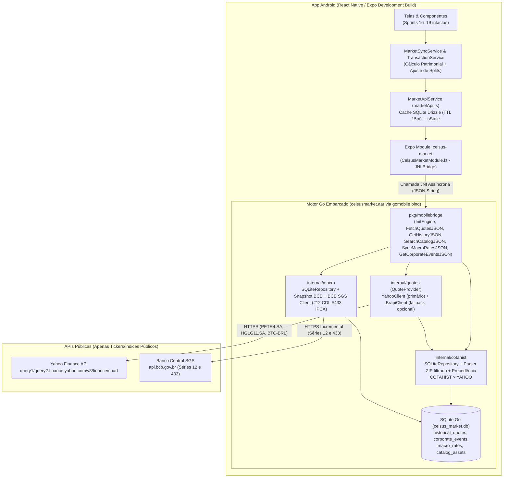

# Plano de Implementação: Unificação do Motor Go no App Mobile (`gomobile`) + Migração para Yahoo Finance (Sprints 20 a 24)

## 1. Objetivo e Contexto Arquitetural

Eliminar a dependência de um servidor externo (`services/market-api` rodando em `http://localhost:8080`) empacotando o motor de dados de mercado em Go diretamente dentro do aplicativo Android via **`gomobile bind -target=android` (`.aar`)** e **Expo Modules API (Kotlin JNI Bridge, sem servidor HTTP local)**. Em paralelo, substituir a BRAPI pelo **Yahoo Finance** (`/v8/finance/chart`), integrar sincronização incremental das séries oficiais do **Banco Central (BCB SGS #12 e #433)** e adicionar o tratamento contábil de **Desdobramentos (Splits) e Grupamentos (Inplits)** sobre a quantidade e o Preço Médio (PM) dos ativos.

> [!IMPORTANT]
> **Registro das Decisões Arquiteturais (`/grill-me`):**
> 1. **Integração Go ↔ Mobile:** Módulo Nativo Direto (Expo Modules API invocando funções Go exportadas no `.aar` que recebem/retornam JSON, sem subir servidor HTTP em `127.0.0.1`). O pacote `internal/http` é preservado apenas para retrocompatibilidade dos testes Go existentes.
> 2. **COTAHIST no Dispositivo:** Histórico buscado sob demanda por ticker via Yahoo Finance (`range=max` / `period1..period2`), mantendo o parser `cotahist.ParseZIP` com filtro de tickers da carteira (`allowedTickers`) para importação local/auditoria soberana.
> 3. **Fonte de Verdade e Precedência:** `close_price` nominal (`indicators.quote[0].close` do Yahoo ou `PREULT` do COTAHIST) é a referência para custo de aquisição e autopreenchimento de transações; `adj_close` é armazenado em coluna separada. Em caso de conflito na mesma `(ticker, trade_date)`, **`COTAHIST` tem precedência estrita sobre `YAHOO`** (`WHERE source != 'COTAHIST'`).
> 4. **Eventos Corporativos (Splits/Grupamentos):** Extrair `events=div,splits` no cliente Go do Yahoo e incluir a **Sprint 24** para recalcular automaticamente quantidade e Preço Médio (PM) em desdobramentos (`numerator > denominator`) e grupamentos (`numerator < denominator`), mantendo o custo total de aquisição inalterado.
> 5. **Resiliência do Cliente de Cotações:** Interface `QuoteProvider` em Go + `yahoo.Client` primário (failover `query1.finance.yahoo.com` → `query2.finance.yahoo.com`, `User-Agent` de navegador, semáforo de concorrência máx. 4 goroutines) + fallback para cache SQLite local e `brapi.Client` opcional legado.
> 6. **Cache e Offline:** Cache persistente em SQLite com **TTL de 15 minutos** (com flag `forceRefresh?: boolean`), expondo `isStale: boolean` e `updatedAt: string` no contrato de `MarketQuote` sem tocar nos layouts visuais das Sprints 16–19.
> 7. **Busca de Tickers (`searchCatalog`):** Catálogo 100% local no SQLite por padrão (zero chamadas de rede durante a digitação no autocomplete), acionando busca no Yahoo apenas se o usuário informar um ticker completo (`>= 4` caracteres) inexistente localmente.
> 8. **Curvas Macro (CDI e IPCA):** Abordagem híbrida — snapshot histórico embarcado no seed + sincronização incremental direta no BCB SGS (séries `12` CDI diário e `433` IPCA mensal) buscando apenas datas posteriores a `MAX(date)`.
> 9. **Licenciamento:** Em produção (`prod`), embarcar apenas o Catálogo Cadastral público (Ticker, Nome, Classe) e o Snapshot BCB (Dados Abertos). Preços históricos e cotações são obtidos sob demanda pelo dispositivo do usuário (o seed de preços fixos de `seed.go` fica restrito a `dev/test`).
> 10. **Escopo de Plataforma:** Exclusivamente **Android** nesta refatoração (`.aar` compilado no Windows/PowerShell + módulo Kotlin, sem criar arquivos Swift/iOS agora).

---

## 2. Auditoria de Privacidade Local-First (Exposição de Rede)

Nenhuma informação de carteira (IDs de carteira, quantidades, preços médios, saldos investidos, datas de compra do usuário ou patrimônio) sai do dispositivo. Abaixo está o inventário exato do que cada chamada externa expõe:

| Destino Externo | Endpoint Chamado pelo Dispositivo | Quando é Acionado | O que é Exposto na Rede | O que NUNCA é Enviado |
| :--- | :--- | :--- | :--- | :--- |
| **Yahoo Finance (Cotações e Histórico)** | `GET https://query1.finance.yahoo.com/v8/finance/chart/{SYMBOL}?range=1mo&interval=1d&events=div,splits` (ou `range=max` / `period1..period2`) | Apenas quando o cache SQLite (TTL 15 min) expira ou em `forceRefresh` para os tickers únicos cadastrados. | • **IP do dispositivo**<br>• **Header `User-Agent`** padronizado<br>• **Ticker público normalizado** com sufixo (`.SA` para B3 ou `-BRL` para Cripto, ex.: `PETR4.SA`, `HGLG11.SA`, `BTC-BRL`)<br>• **Janela pública de datas** (`range=1mo` ou `range=max`) | Quantidade de cotas, Preço Médio, saldo em R$, data exata da transação do investidor (usa janelas genéricas `1mo`/`max`), nome da carteira ou ID do usuário. |
| **Yahoo Finance (Fallback de Catálogo)** | `GET https://query1.finance.yahoo.com/v1/finance/search?q={TICKER}&quotesCount=5` | Somente se uma busca de código completo (`>= 4` chars) retornar 0 resultados no catálogo SQLite local. | • **IP do dispositivo**<br>• **String do ticker buscado** | Digitações parciais no autocomplete (`P`, `PE`, `PET`) são 100% resolvidas no SQLite local sem rede. |
| **Banco Central do Brasil (BCB SGS)** | `GET https://api.bcb.gov.br/dados/serie/bcdata.sgs.{12\|433}/dados?formato=json&dataInicial={DD/MM/YYYY}&dataFinal={DD/MM/YYYY}` | Quando `MAX(date)` na tabela `macro_rates` está defasada em relação à data atual. | • **IP do dispositivo**<br>• **Código da série pública** (`12` = CDI, `433` = IPCA)<br>• **Janela incremental** (`MAX(date)+1` até hoje) | Nenhum ticker, nenhum valor investido, nenhuma taxa contratada (`% CDI`) dos títulos de Renda Fixa do usuário. |
| **B3 COTAHIST (Opcional/Offline)** | Leitura de arquivo `.ZIP` local (`IngestCotahistZip`) | Quando o usuário importa um arquivo `.ZIP` local. | **Zero tráfego de rede** (processamento 100% em disco local). | Nenhuma chamada externa. |

---

## 3. Arquitetura Alvo (Pós-Refatoração)



---

## 4. Spike Inicial (Pré-Sprint 20 — Sem TDD Lock)

Antes de iniciar a **Sprint 20 (Fase A)** e bloquear testes, executaremos um **Spike Técnico de Validação** (sem alterar testes bloqueados existentes) para confirmar em ambiente real Windows/PowerShell as duas premissas centrais:

### 4.1. Parte A do Spike — Validação Real do Contrato Yahoo Finance e BCB SGS
Um script/comando Go temporário (`services/market-api/cmd/spike_yahoo/main.go`) fará chamadas reais para:
1. `https://query1.finance.yahoo.com/v8/finance/chart/PETR4.SA?range=1mo&interval=1d&events=div,splits`
2. `https://query1.finance.yahoo.com/v8/finance/chart/HGLG11.SA?range=1mo&interval=1d&events=div,splits`
3. `https://query1.finance.yahoo.com/v8/finance/chart/BTC-BRL?range=1mo&interval=1d&events=div,splits`
4. `https://api.bcb.gov.br/dados/serie/bcdata.sgs.12/dados?formato=json&dataInicial=01/01/2026&dataFinal=31/01/2026`

**O que o Spike A deve confirmar e gerar:**
- Confirmar o header `User-Agent` aceito sem `429`/`403`.
- Confirmar a estrutura exata de `chart.result[0].meta` (`regularMarketPrice`, `chartPreviousClose`, `regularMarketTime`, `symbol`), `chart.result[0].timestamp[]`, `chart.result[0].indicators.quote[0].close[]`, `chart.result[0].indicators.adjclose[0].adjclose[]` e `chart.result[0].events.splits` / `dividends`.
- Confirmar a regra de normalização de ticker:
  - Entrada `PETR4` → envia `PETR4.SA` ao Yahoo → retorna `PETR4` limpo (sem `.SA`) para o app.
  - Entrada `HGLG11` → envia `HGLG11.SA` ao Yahoo → retorna `HGLG11` limpo (sem `.SA`).
  - Entrada `BTC` → envia `BTC-BRL` ao Yahoo → retorna `BTC` limpo (sem `-BRL`).
- Gravar os payloads JSON reais (truncados para 5 pregões) em `services/market-api/internal/yahoo/testdata/` para uso determinístico nos testes `httptest` da Sprint 20 (zero chamadas de rede no CI).

### 4.2. Parte B do Spike — Hello World `gomobile bind` + Expo Module no Android (Windows/PowerShell)
1. Verificar/instalar `golang.org/x/mobile/cmd/gomobile` e `gobind` no ambiente Windows e validar `ANDROID_HOME` e `ANDROID_NDK_HOME`.
2. Nota técnica importante de compatibilidade: `services/market-api/go.mod` declara `go 1.26.4` e usa `modernc.org/sqlite` (100% pure Go, sem CGo para o SQLite, enquanto `gomobile bind` usa o NDK CGo apenas para gerar a ponte JNI `.so` dentro do `.aar`). O spike validará a geração de `celsusmarket.aar` com `gomobile bind -target=android/arm64,android/amd64 -androidapi 24`.
3. Criar o módulo local `apps/mobile/modules/celsus-market` com uma função `helloBridge(): string` que chama o `.aar` e validar a compilação Android (`npx expo prebuild --platform android` / Gradle build).

---

## 5. Plano Detalhado de Sprints (Sprints 20 a 24)

### Mapa Geral das Sprints 20 a 24

| Sprint | Foco Técnico Principal | Módulos Afetados |
| :---: | :--- | :--- |
| **Sprint 20** | **Cliente Yahoo Finance (`internal/yahoo`) + Interface `QuoteProvider` + Cliente Incremental BCB SGS (`internal/macro/bcb.go`)** | `services/market-api/internal/quotes`<br>`services/market-api/internal/yahoo`<br>`services/market-api/internal/macro`<br>`services/market-api/internal/http` |
| **Sprint 21** | **Motor Local SQLite Go: Precedência `COTAHIST > YAHOO`, `adj_close`, Eventos Corporativos, Filtro `.ZIP` por Carteira e Licenciamento de Seed** | `services/market-api/internal/cotahist`<br>`services/market-api/internal/macro` |
| **Sprint 22** | **Fachada Mobile Go (`pkg/mobilebridge`) + Automação `gomobile bind` Android (`.aar`) no Windows** | `services/market-api/pkg/mobilebridge`<br>`scripts/build-gomobile-android.ps1` |
| **Sprint 23** | **Expo Module Nativo Android (`modules/celsus-market`) + Refatoração de `MarketApiService` (Cache TTL 15m, `isStale`, Zero Servidor HTTP)** | `apps/mobile/modules/celsus-market`<br>`apps/mobile/src/services/marketApi.ts`<br>`apps/mobile/app.json` |
| **Sprint 24** | **Eventos Corporativos na Carteira: Desdobramentos (`Splits`) e Grupamentos (`Inplits`) com Recálculo de PM e Quantidade** | `apps/mobile/src/domain/finance/corporateEvents.ts`<br>`apps/mobile/src/domain/finance/averagePrice.ts`<br>`apps/mobile/src/services/marketSyncService.ts`<br>`apps/mobile/src/db/schema.ts` |

---

### SPRINT 20 — Cliente Yahoo Finance (`internal/yahoo`), Interface `QuoteProvider` e Cliente BCB SGS (`internal/macro`)

- **Objetivo:** Substituir o acoplamento direto à BRAPI por uma interface `QuoteProvider`, implementar o cliente completo do Yahoo Finance (Ações/FIIs `.SA` e Cripto `-BRL`, retornando tickers limpos sem `.SA`/`-BRL`, histórico com `close` nominal, `adjclose` e `events=div,splits`, failover `query1` → `query2` e `User-Agent`) e implementar o cliente HTTP incremental do BCB SGS para CDI (série 12) e IPCA (série 433).
- **Módulos Afetados:**
  - `[NEW]` `services/market-api/internal/quotes/provider.go`
  - `[NEW]` `services/market-api/internal/yahoo/client.go`
  - `[NEW]` `services/market-api/internal/yahoo/client_test.go`
  - `[NEW]` `services/market-api/internal/yahoo/testdata/*.json`
  - `[NEW]` `services/market-api/internal/macro/bcb_client.go`
  - `[MODIFY]` `services/market-api/internal/macro/rates_test.go`
  - `[MODIFY]` `services/market-api/internal/brapi/client.go` (implementa `quotes.QuoteProvider` como adaptador legado opcional)
  - `[MODIFY]` `services/market-api/internal/http/server.go` e `handlers.go` (passa a receber `quotes.QuoteProvider`)

#### Especificação Técnica da Sprint 20
1. **Normalização de Tickers no Yahoo (`internal/yahoo/client.go`):**
   - `ToYahooSymbol(ticker, assetClass)`:
     - Se `isCryptoTicker(ticker)` ou `assetClass == "CRYPTO"`: `BTC` → `BTC-BRL`, `ETH` → `ETH-BRL`, `SOL` → `SOL-BRL`.
     - Caso contrário (Ações, FIIs, ETFs, BDRs da B3): se não terminar em `.SA`, adiciona `.SA` (`PETR4` → `PETR4.SA`, `HGLG11` → `HGLG11.SA`).
   - `FromYahooSymbol(symbol)`:
     - Remove sufixos `.SA` e `-BRL` (`PETR4.SA` → `PETR4`, `HGLG11.SA` → `HGLG11`, `BTC-BRL` → `BTC`). **Nenhum ticker retornado pelo cliente ou salvo no banco deve conter `.SA` ou `-BRL`.**
2. **Extração de Cotação, Histórico e Eventos (`events=div,splits`):**
   - Endpoint: `{baseURL}/v8/finance/chart/{yahooSymbol}?range={range}&interval=1d&events=div,splits`.
   - `FetchQuotes(ctx, tickers)`: busca cotações (com cache TTL de 15 min e semáforo de até 4 goroutines simultâneas), calculando `Change24h` a partir de `(regularMarketPrice - chartPreviousClose) / chartPreviousClose * 100` caso `regularMarketChangePercent` não venha no `meta`, e devolvendo o ticker limpo (`PETR4`, `HGLG11`, `BTC`).
   - `FetchChartHistory(ctx, ticker, rangeOrPeriod)`: retorna slice de `HistoricalBar` (`Date`, `Open`, `High`, `Low`, `Close` nominal de `indicators.quote[0].close`, `AdjClose` de `indicators.adjclose[0].adjclose`, `Volume`) + slice de `CorporateEvent` (`Type: "SPLIT" | "DIVIDEND"`, `Date`, `Numerator`, `Denominator`, `Ratio`, `CashAmount`).
   - Failover automático: se `query1.finance.yahoo.com` retornar erro de rede, `5xx` ou `429`, tenta `query2.finance.yahoo.com` antes de retornar erro.
3. **Cliente BCB SGS (`internal/macro/bcb_client.go`):**
   - `FetchSGSSeries(ctx, seriesCode int, fromDate, toDate string)`: consulta `/dados/serie/bcdata.sgs.{12|433}/dados?formato=json&dataInicial=DD/MM/YYYY&dataFinal=DD/MM/YYYY`, converte `data` (`DD/MM/YYYY` → `YYYY-MM-DD`) e `valor` string decimal para `Rate{Date, Type, Value}`.

#### Fase A (Autoria e Bloqueio de Testes — Sprint 20)
- Arquivos de teste a criar/atualizar e bloquear em `tests.lock.json`:
  1. `services/market-api/internal/yahoo/client_test.go`:
     - `TestTickerNormalization`: valida `PETR4` ↔ `PETR4.SA`, `HGLG11` ↔ `HGLG11.SA`, `BTC` ↔ `BTC-BRL` e garante que o `Quote.Ticker` final nunca contém `.SA`.
     - `TestFetchQuotes_SuccessAndCache`: usa `httptest.Server` com fixtures reais de `PETR4.SA`, `HGLG11.SA` e `BTC-BRL`, verifica preços, variação 24h, header `User-Agent` obrigatório e hit de cache TTL sem nova chamada HTTP.
     - `TestFetchChartHistory_CloseAdjCloseAndSplits`: valida parse de `indicators.quote[0].close` vs `indicators.adjclose[0].adjclose` e extração de `events.splits` (ex.: `numerator: 2, denominator: 1`) e `events.dividends`.
     - `TestFetchQuotes_FailoverQuery1ToQuery2`: simula `429 Too Many Requests` no host primário e verifica sucesso automático no host secundário (`query2`).
  2. `services/market-api/internal/macro/rates_test.go`:
     - `TestBCBClient_FetchIncrementalCDIAndIPCA`: usa `httptest.Server` simulando o payload JSON do BCB SGS (`[{"data":"02/01/2026","valor":"0.050788"}]`), verifica conversão de data `DD/MM/YYYY` → `YYYY-MM-DD` e sincronização incremental a partir de `GetLastDate`.

##### Prompt da Sprint 20 — Fase A
```markdown
Vamos executar a **Sprint 20 — Fase A (TDD: Especificação e Bloqueio de Testes)** conforme o plano aprovado.

1. Desbloqueie os testes (`powershell -ExecutionPolicy Bypass -File ./scripts/test-lock.ps1 -Action unlock`).
2. Crie a interface `QuoteProvider` em `services/market-api/internal/quotes/provider.go` e as assinaturas/stubs de `services/market-api/internal/yahoo/client.go` e `services/market-api/internal/macro/bcb_client.go`.
3. Escreva os testes em `services/market-api/internal/yahoo/client_test.go` e `services/market-api/internal/macro/rates_test.go` usando exclusivamente `httptest.Server` e as fixtures gravadas (zero chamadas de rede real).
4. Bloqueie os testes (`powershell -ExecutionPolicy Bypass -File ./scripts/test-lock.ps1 -Action lock`) e atualize `TEST_REPORT.md`.
5. Faça o commit e push da Fase A: `git add . ; git commit -m "test(sprint-20): add and lock phase A yahoo client and bcb sgs tests" ; git push origin main`.
```

#### Fase B (Implementação sob Bloqueio — Sprint 20)
##### Prompt da Sprint 20 — Fase B
```markdown
Vamos executar a **Sprint 20 — Fase B (Implementação TDD sob Bloqueio)**.

REGRAS OBRIGATÓRIAS:
- Não edite nenhum arquivo de teste bloqueado em `tests.lock.json`.

Passos:
1. Implemente `services/market-api/internal/yahoo/client.go` (normalização `.SA`/`-BRL` com remoção no retorno, parse de `/v8/finance/chart`, `close` vs `adjclose`, `events=div,splits`, header `User-Agent`, cache TTL e failover `query1` → `query2`).
2. Implemente `services/market-api/internal/macro/bcb_client.go` (cliente BCB SGS séries 12 e 433 com janela incremental).
3. Adapte `internal/http/server.go` e `handlers.go` para usar `quotes.QuoteProvider`, preservando 100% dos testes existentes em `internal/http/handlers_test.go` e `internal/brapi/client_test.go`.
4. Rode `go test ./...` em `services/market-api`, verifique o lock com `powershell -ExecutionPolicy Bypass -File ./scripts/test-lock.ps1 -Action verify` e atualize `TEST_REPORT.md`.
5. Faça o commit e push da Fase B: `git add . ; git commit -m "feat(sprint-20): complete phase B yahoo finance provider and bcb sgs client" ; git push origin main`.
```

- **Critérios de Aceite (Sprint 20):**
  - `go test ./...` passa 100% sem acessar a internet.
  - Tickers retornados por `yahoo.Client` nunca contêm `.SA` ou `-BRL`.
  - `test-lock.ps1 -Action verify` aprova sem divergências.
- **Riscos e Rollback:**
  - *Risco:* Mudança em campos nulos do JSON do Yahoo em pregões sem negociação (`null` dentro do array `close`). *Mitigação:* Ignorar índices onde `close[i] == nil` ao montar `HistoricalBar`.
  - *Rollback:* Reverter injeção de `QuoteProvider` para `brapi.Client` via construtor de `NewServer`.

---

### SPRINT 21 — Motor SQLite Go: Precedência `COTAHIST > YAHOO`, Eventos Corporativos, Filtro `.ZIP` e Licenciamento de Seed

- **Objetivo:** Evoluir o repositório SQLite em Go (`internal/cotahist` e `internal/macro`) para:
  1. Armazenar `adj_close` e `source` (`'COTAHIST'` | `'YAHOO'`) em `historical_quotes` garantindo que `COTAHIST` nunca seja sobrescrito por `YAHOO`.
  2. Persistir eventos corporativos (`corporate_events`: splits e dividendos) extraídos do Yahoo.
  3. Permitir ingestão de arquivos `.ZIP` do COTAHIST filtrada apenas pelos tickers da carteira do usuário (`ParseZIPFiltered`).
  4. Separar o catálogo cadastral público (`catalog_assets`: Ticker, Nome, Classe) + snapshot BCB (embarcados em produção) do seed de preços de teste (`SeedDevMarketPrices`), atendendo à regra de licenciamento.
- **Módulos Afetados:**
  - `[MODIFY]` `services/market-api/internal/cotahist/cotahist.go`
  - `[MODIFY]` `services/market-api/internal/cotahist/repository.go`
  - `[MODIFY]` `services/market-api/internal/cotahist/seed.go`
  - `[NEW]` `services/market-api/internal/cotahist/catalog_seed.go`
  - `[MODIFY]` `services/market-api/internal/cotahist/repository_test.go`
  - `[MODIFY]` `services/market-api/internal/cotahist/seed_test.go`

#### Fase A (Autoria e Bloqueio de Testes — Sprint 21)
- Casos de teste em `repository_test.go` e `seed_test.go`:
  - `TestUpsertQuotes_PrecedenceCotahistOverYahoo`: insere `PETR4` em `2024-01-02` com `source="COTAHIST"` (`close=38.50`), tenta fazer upsert da mesma data com `source="YAHOO"` (`close=38.42, adj_close=34.10`) e comprova que `close_price` permanece `38.50` e `source` permanece `'COTAHIST'` (mas `adj_close` pode ser preenchido se estava nulo); já um registro com `source="YAHOO"` é atualizado por outro `'YAHOO'` ou promovido para `'COTAHIST'`.
  - `TestParseZIPFiltered_OnlyAllowedTickers`: passa um `.ZIP` contendo `PETR4`, `VALE3` e `ITUB4` com filtro `allowedTickers: ["PETR4"]` e comprova que apenas `PETR4` é emitido/persistido.
  - `TestCorporateEvents_SaveAndQuery`: salva eventos de split (`2:1`) e dividendo de um ticker no SQLite e consulta por intervalo de datas.
  - `TestProductionSeed_LicensingCompliance`: valida que `SeedProductionCatalogAndMacro` popula o catálogo cadastral (`catalog_assets`) e as séries públicas CDI/IPCA do BCB, deixando `historical_quotes` com **zero preços pré-gravados** em modo produção (enquanto `SeedMarketData` de dev/test continua populando os preços de exemplo para os testes legados).

##### Prompt da Sprint 21 — Fase A
```markdown
Vamos executar a **Sprint 21 — Fase A (TDD: Especificação e Bloqueio de Testes)** conforme o plano aprovado.

1. Desbloqueie os testes (`powershell -ExecutionPolicy Bypass -File ./scripts/test-lock.ps1 -Action unlock`).
2. Atualize as structs e assinaturas em `internal/cotahist/cotahist.go`, `repository.go` e `seed.go` (`Source`, `AdjClose`, `CorporateEvent`, `ParseZIPFiltered`, `SeedProductionCatalogAndMacro`).
3. Adicione os novos testes em `services/market-api/internal/cotahist/repository_test.go` e `seed_test.go`.
4. Bloqueie os testes (`powershell -ExecutionPolicy Bypass -File ./scripts/test-lock.ps1 -Action lock`) e atualize `TEST_REPORT.md`.
5. Faça o commit e push da Fase A: `git add . ; git commit -m "test(sprint-21): add and lock phase A cotahist precedence, zip filter and licensing seed tests" ; git push origin main`.
```

#### Fase B (Implementação sob Bloqueio — Sprint 21)
##### Prompt da Sprint 21 — Fase B
```markdown
Vamos executar a **Sprint 21 — Fase B (Implementação TDD sob Bloqueio)**.

REGRAS OBRIGATÓRIAS:
- Não edite nenhum arquivo de teste bloqueado em `tests.lock.json`.

Passos:
1. Atualize o schema SQLite em `internal/cotahist/repository.go` adicionando `adj_close REAL`, `source TEXT NOT NULL DEFAULT 'COTAHIST'`, a tabela `corporate_events` e a tabela `catalog_assets`.
2. Implemente a query `ON CONFLICT(ticker, trade_date) DO UPDATE` que preserva `close_price` e `source` quando `historical_quotes.source = 'COTAHIST'` e o novo registro vier de `'YAHOO'`.
3. Implemente `ParseZIPFiltered(zipPath, allowedTickers, handleQuote)` em `cotahist.go`.
4. Implemente `SeedProductionCatalogAndMacro` em `catalog_seed.go` contendo apenas o catálogo cadastral público da B3/Cripto e o snapshot histórico aberto do BCB (CDI/IPCA), mantendo `SeedMarketData` intacto para os testes existentes.
5. Rode `go test ./...`, verifique o lock com `powershell -ExecutionPolicy Bypass -File ./scripts/test-lock.ps1 -Action verify` e atualize `TEST_REPORT.md`.
6. Faça o commit e push da Fase B: `git add . ; git commit -m "feat(sprint-21): complete phase B precedence rules, filtered cotahist and production seed" ; git push origin main`.
```

- **Critérios de Aceite (Sprint 21):**
  - Registros `COTAHIST` nunca são sobrescritos por `YAHOO`.
  - `SeedProductionCatalogAndMacro` popula catálogo + BCB com 0 preços proprietários pré-gravados.
- **Riscos e Rollback:**
  - *Risco:* Bancos SQLite já criados em testes antigos sem as colunas `adj_close` e `source`. *Mitigação:* `InitSchema` executa `ALTER TABLE historical_quotes ADD COLUMN ...` de forma idempotente caso a tabela já exista.

---

### SPRINT 22 — Fachada Go para Mobile (`pkg/mobilebridge`) e Build `.aar` (`gomobile bind`)

- **Objetivo:** Criar o pacote exportável `pkg/mobilebridge` compatível com as restrições de tipos do `gomobile bind` (apenas tipos primitivos `string`, `int`, `bool` e `error` nas assinaturas públicas) expondo todas as operações do motor de mercado via JSON, sem servidor HTTP, e automatizar a compilação do `.aar` no Windows via PowerShell.
- **Módulos Afetados:**
  - `[NEW]` `services/market-api/pkg/mobilebridge/bridge.go`
  - `[NEW]` `services/market-api/pkg/mobilebridge/bridge_test.go`
  - `[NEW]` `scripts/build-gomobile-android.ps1`
  - `[MODIFY]` `services/market-api/go.mod` (`golang.org/x/mobile/bind`)

#### Especificação da API `pkg/mobilebridge` (Compatível com `gomobile bind`)
Todas as funções exportadas no pacote `mobilebridge` (que no Kotlin/Java viram `mobilebridge.Mobilebridge.*`) operam diretamente sobre o banco SQLite local no diretório de arquivos do app Android (`dbPath`):
- `InitEngine(dbPath string, isProd bool) error`: abre o SQLite em `dbPath`, roda `InitSchema`, executa `SeedProductionCatalogAndMacro` (se `isProd == true`) ou `SeedMarketData` (se `isProd == false`), e inicializa o singleton `Engine` com `yahoo.Client` e `macro.BCBClient`.
- `CheckHealthJSON() (string, error)`: retorna `{"status":"ok","cotahist_last_date":"...","provider":"YAHOO"}`.
- `FetchQuotesJSON(tickersCSV string, forceRefresh bool) (string, error)`: busca cotações no cache SQLite (TTL 15m) ou no Yahoo Finance, persiste no SQLite e retorna JSON `{"quotes":[...]}` com `ticker` (sem `.SA`), `asset_class`, `current_price`, `change_percent_24h`, `updated_at`, `is_stale`.
- `GetHistoricalPriceJSON(ticker string, date string) (string, error)`: consulta `historical_quotes` local; se não encontrar a data, sincroniza o histórico do `ticker` via Yahoo Finance (`range=max`), salva no SQLite respeitando a precedência `COTAHIST > YAHOO` (e salvando `corporate_events`), e retorna `{"ticker":"...","date":"...","close_price":"...","adj_close":"...","source":"..."}`.
- `SearchCatalogJSON(query string, assetClass string) (string, error)`: busca instantaneamente em `catalog_assets` no SQLite local (zero rede); somente se `len(strings.TrimSpace(query)) >= 4` e o resultado local for vazio, consulta o fallback do Yahoo e cadastra o item no catálogo local.
- `FetchMacroRatesJSON(fromDate string) (string, error)`: sincroniza incrementalmente o delta do BCB SGS (séries 12 e 433) a partir de `MAX(date)` (com fallback gracioso offline para o snapshot SQLite) e retorna `[{"date":"...","cdi":...,"ipca":...}]`.
- `GetCorporateEventsJSON(tickersCSV string, fromDate string) (string, error)`: retorna os eventos de `SPLIT` e `DIVIDEND` registrados para os tickers informados.
- `IngestCotahistZipJSON(zipPath string, allowedTickersCSV string) (string, error)`: importa um `.ZIP` local da B3 filtrando pelos tickers da carteira e retorna `{"imported_count": N}`.

#### Fase A (Autoria e Bloqueio de Testes — Sprint 22)
- Casos de teste em `services/market-api/pkg/mobilebridge/bridge_test.go`:
  - `TestBridge_InitAndSearchCatalogOffline`: inicializa `InitEngine` em arquivo SQLite temporário (`isProd = true`), realiza buscas parciais (`"PET"`, `"HGLG"`, `"BTC"`) e verifica retorno em `< 5ms` com 0 chamadas HTTP.
  - `TestBridge_FetchQuotesJSON_TTLAndStaleFallback`: testa `FetchQuotesJSON` com `httptest` do Yahoo, verifica cache de 15 min, testa `forceRefresh = true` e simula queda da rede para validar retorno do cache SQLite com `"is_stale": true`.
  - `TestBridge_GetHistoricalPriceJSON_OnDemandSync`: pede preço de uma data não presente localmente, verifica que a ponte baixa do Yahoo mockado, salva no SQLite e retorna o `close_price` nominal (e não o `adj_close`).

##### Prompt da Sprint 22 — Fase A
```markdown
Vamos executar a **Sprint 22 — Fase A (TDD: Especificação e Bloqueio de Testes)** conforme o plano aprovado.

1. Desbloqueie os testes (`powershell -ExecutionPolicy Bypass -File ./scripts/test-lock.ps1 -Action unlock`).
2. Crie as assinaturas exportadas em `services/market-api/pkg/mobilebridge/bridge.go`.
3. Escreva os testes da ponte mobile em `services/market-api/pkg/mobilebridge/bridge_test.go`.
4. Bloqueie os testes (`powershell -ExecutionPolicy Bypass -File ./scripts/test-lock.ps1 -Action lock`) e atualize `TEST_REPORT.md`.
5. Faça o commit e push da Fase A: `git add . ; git commit -m "test(sprint-22): add and lock phase A mobilebridge json api tests" ; git push origin main`.
```

#### Fase B (Implementação sob Bloqueio — Sprint 22)
##### Prompt da Sprint 22 — Fase B
```markdown
Vamos executar a **Sprint 22 — Fase B (Implementação TDD sob Bloqueio)**.

REGRAS OBRIGATÓRIAS:
- Não edite nenhum arquivo de teste bloqueado em `tests.lock.json`.

Passos:
1. Implemente `services/market-api/pkg/mobilebridge/bridge.go` integrando `cotahist.SQLiteRepository`, `macro.SQLiteRepository`, `yahoo.Client` e `macro.BCBClient`.
2. Crie o script `scripts/build-gomobile-android.ps1` que compila `github.com/pedro/celsus/services/market-api/pkg/mobilebridge` via `gomobile bind -target=android -androidapi 24` e deposita `celsusmarket.aar` em `apps/mobile/modules/celsus-market/android/libs/celsusmarket.aar`.
3. Rode `go test ./...`, execute `./scripts/build-gomobile-android.ps1` para validar a geração do `.aar`, verifique o lock com `powershell -ExecutionPolicy Bypass -File ./scripts/test-lock.ps1 -Action verify` e atualize `TEST_REPORT.md`.
4. Faça o commit e push da Fase B: `git add . ; git commit -m "feat(sprint-22): complete phase B mobilebridge package and gomobile android build script" ; git push origin main`.
```

- **Critérios de Aceite (Sprint 22):**
  - `go test ./pkg/mobilebridge/...` passa 100%.
  - `scripts/build-gomobile-android.ps1` gera `celsusmarket.aar` com código de saída `0`.

---

### SPRINT 23 — Expo Module Nativo Android (`celsus-market`) e Unificação em `MarketApiService`

- **Objetivo:** Criar o módulo nativo Android `apps/mobile/modules/celsus-market` (usando Expo Modules API em Kotlin para vincular o `celsusmarket.aar` e rodar na thread de I/O) e refatorar `MarketApiService` (`apps/mobile/src/services/marketApi.ts`) para invocar o motor Go embarcado diretamente (sem `http://localhost:8080`), aplicando cache SQLite com TTL de 15 minutos, suporte a `forceRefresh` e metadado `isStale`.
- **Módulos Afetados:**
  - `[NEW]` `apps/mobile/modules/celsus-market/expo-module.config.json`
  - `[NEW]` `apps/mobile/modules/celsus-market/index.ts`
  - `[NEW]` `apps/mobile/modules/celsus-market/android/build.gradle`
  - `[NEW]` `apps/mobile/modules/celsus-market/android/src/main/java/expo/modules/celsusmarket/CelsusMarketModule.kt`
  - `[MODIFY]` `apps/mobile/src/services/marketApi.ts`
  - `[MODIFY]` `apps/mobile/src/services/__tests__/marketApiIntegration.test.ts` (ou novo `Sprint23NativeMarketEngine.test.ts`)

#### Especificação Técnica da Sprint 23
1. **Módulo Kotlin (`CelsusMarketModule.kt`):**
   - No `OnCreate`, obtém `appContext.reactContext?.filesDir` e chama `Mobilebridge.initEngine( File(filesDir, "celsus_market.db").absolutePath, true )`.
   - Expõe `AsyncFunction("checkHealth")`, `AsyncFunction("fetchQuotes")`, `AsyncFunction("getHistoricalPrice")`, `AsyncFunction("searchCatalog")`, `AsyncFunction("fetchMacroRates")`, `AsyncFunction("getCorporateEvents")` e `AsyncFunction("ingestCotahistZip")`.
2. **Adaptação de `MarketApiService` (`apps/mobile/src/services/marketApi.ts`):**
   - Recebe opcionalmente uma interface `INativeMarketBridge` no construtor (por padrão aponta para o módulo nativo `CelsusMarketNativeModule`, com fallback para mock/adapter nos testes Jest em Node.js).
   - **Cache SQLite com TTL de 15 minutos (`CACHE_TTL_MS = 15 * 60 * 1000`):**
     - Em `fetchQuotes(tickers, options?: { forceRefresh?: boolean })`:
       - Se `!options?.forceRefresh`, verifica primeiro `market_price_cache` no SQLite local. Se todos os tickers solicitados tiverem `Date.now() - Date.parse(updated_at) < 15 * 60 * 1000`, retorna diretamente do SQLite local com `isStale: false` (zero chamadas ao bridge/rede).
       - Caso contrário, chama a bridge nativa Go (`fetchQuotes`), atualiza `market_price_cache` e retorna as cotações.
       - Se a rede falhar, retorna os registros de `market_price_cache` com `isStale: true` e `updatedAt` preservado.

#### Fase A (Autoria e Bloqueio de Testes — Sprint 23)
- Criar `apps/mobile/src/services/__tests__/Sprint23NativeMarketBridgeAndTTL.test.ts` (sem editar `marketApiIntegration.test.ts` bloqueado, mantendo retrocompatibilidade caso `apiBaseUrl` seja passado nos testes legados):
  - `S23-T01`: Verifica que `MarketApiService` invoca `nativeBridge.fetchQuotes`, `getHistoricalPrice`, `searchCatalog` e `fetchMacroRates` diretamente sem chamar `global.fetch('http://localhost:8080/...')` quando a bridge nativa está presente.
  - `S23-T02`: Verifica o **TTL de 15 minutos** no `market_price_cache`: cotações com `updated_at` de 5 minutos atrás são retornadas do SQLite com `isStale: false` sem acionar a rede; com `forceRefresh: true` ou após 16 minutos, aciona a atualização.
  - `S23-T03`: Verifica comportamento **Offline / Stale**: quando a fonte externa falha, retorna a cotação salva anteriormente em `market_price_cache` marcada com `isStale: true` e o `updatedAt` original intacto, e garante que nenhum ticker tem sufixo `.SA`.

##### Prompt da Sprint 23 — Fase A
```markdown
Vamos executar a **Sprint 23 — Fase A (TDD: Especificação e Bloqueio de Testes)** conforme o plano aprovado.

1. Desbloqueie os testes (`powershell -ExecutionPolicy Bypass -File ./scripts/test-lock.ps1 -Action unlock`).
2. Crie o esqueleto do módulo `apps/mobile/modules/celsus-market/index.ts` e atualize as assinaturas de `MarketQuote` (`isStale?: boolean`, `source?: string`) e `MarketApiService` em `apps/mobile/src/services/marketApi.ts`.
3. Crie a suíte de testes `apps/mobile/src/services/__tests__/Sprint23NativeMarketBridgeAndTTL.test.ts`.
4. Bloqueie os testes (`powershell -ExecutionPolicy Bypass -File ./scripts/test-lock.ps1 -Action lock`) e atualize `TEST_REPORT.md`.
5. Faça o commit e push da Fase A: `git add . ; git commit -m "test(sprint-23): add and lock phase A native market bridge and 15m ttl cache tests" ; git push origin main`.
```

#### Fase B (Implementação sob Bloqueio — Sprint 23)
##### Prompt da Sprint 23 — Fase B
```markdown
Vamos executar a **Sprint 23 — Fase B (Implementação TDD sob Bloqueio)**.

REGRAS OBRIGATÓRIAS:
- Não edite nenhum arquivo de teste bloqueado em `tests.lock.json`.

Passos:
1. Implemente `apps/mobile/modules/celsus-market` (`expo-module.config.json`, `android/build.gradle` vinculando `libs/celsusmarket.aar`, `CelsusMarketModule.kt` e `index.ts`).
2. Refatore `apps/mobile/src/services/marketApi.ts` para priorizar a bridge nativa Go (`celsus-market`), implementar o TTL de 15 minutos no SQLite, suportar `forceRefresh` e expor `isStale` e `updatedAt` (preservando o fallback `fetch` quando `nativeBridge` não estiver presente no ambiente Jest legado).
3. Rode `npm --prefix apps/mobile test -- --runInBand`, verifique o lock com `powershell -ExecutionPolicy Bypass -File ./scripts/test-lock.ps1 -Action verify` e atualize `TEST_REPORT.md`.
4. Faça o commit e push da Fase B: `git add . ; git commit -m "feat(sprint-23): complete phase B android expo module and native marketApi integration" ; git push origin main`.
```

- **Critérios de Aceite (Sprint 23):**
  - 100% dos testes Jest do mobile (`npm --prefix apps/mobile test`) passam, incluindo `marketApiIntegration.test.ts` e `Sprint23NativeMarketBridgeAndTTL.test.ts`.
  - Nenhuma tela ou componente visual das Sprints 16–19 é alterado.

---

### SPRINT 24 — Eventos Corporativos na Carteira: Desdobramentos (`Splits`) e Grupamentos (`Inplits`)

- **Objetivo:** Resolver a distorção de Preço Médio (PM) e Quantidade causada por desdobramentos (*splits*, ex.: `1:2` → `2` novas ações para cada `1`) e grupamentos (*inplits*, ex.: `10:1` → `1` nova ação para cada `10`) usando os eventos `events=splits` capturados do Yahoo Finance, preservando o Custo Total de Aquisição fiscal e garantindo idempotência (um mesmo split nunca é aplicado duas vezes).
- **Módulos Afetados:**
  - `[MODIFY]` `apps/mobile/src/db/schema.ts` (suporte a transações/eventos de `SPLIT` / `INPLIT` ou tabela `applied_corporate_events`)
  - `[NEW]` `apps/mobile/src/domain/finance/corporateEvents.ts`
  - `[MODIFY]` `apps/mobile/src/domain/finance/averagePrice.ts`
  - `[MODIFY]` `apps/mobile/src/domain/finance/types.ts`
  - `[MODIFY]` `apps/mobile/src/services/marketSyncService.ts`
  - `[NEW]` `apps/mobile/src/domain/finance/__tests__/Sprint24CorporateEventsSplitInplit.test.ts`

#### Especificação Matemática de Splits e Grupamentos (`SPEC.md` Add-on)
Seja uma posição acumulada antes da data ex-evento (`exDate`) com Quantidade $Q_{\text{ant}} > 0$, Preço Médio $PM_{\text{ant}}$ e Custo Total $C_{\text{total}} = Q_{\text{ant}} \times PM_{\text{ant}}$:
- Dado um evento de proporção $r = \frac{\text{numerator}}{\text{denominator}}$ (onde $r > 1$ é **Desdobramento/Split** e $0 < r < 1$ é **Grupamento/Inplit**):
  $$Q_{\text{nova}} = Q_{\text{ant}} \times \frac{\text{numerator}}{\text{denominator}}$$
  $$PM_{\text{novo}} = \frac{C_{\text{total}}}{Q_{\text{nova}}} = PM_{\text{ant}} \times \frac{\text{denominator}}{\text{numerator}}$$
- **Invariante Fiscal Obrigatória:** O custo total de aquisição ($Q_{\text{nova}} \times PM_{\text{novo}} = C_{\text{total}}$) permanece **estritamente inalterado**.
- **Reconciliação Cronológica (`calculatePositionFromTransactions`):**
  - Ao reconstruir a posição de um ativo a partir do livro-razão de transações (`BUY`, `SELL`, `SPLIT`, `INPLIT`) ordenado por `trade_date ASC`:
    - Apenas o saldo acumulado em datas **estritamente anteriores** à data `exDate` do split/inplit sofre o fator $r = \frac{\text{numerator}}{\text{denominator}}$. Compras realizadas na própria `exDate` ou depois dela já ocorreram na cotação pós-split e não são multiplicadas novamente.
  - **Idempotência na Sincronização (`MarketSyncService`):** Cada evento do Yahoo é identificado deterministicamente por `external_id = "YAHOO_SPLIT_${ticker}_${exDate}_${numerator}:${denominator}"`. Ao sincronizar a carteira, o serviço verifica se já existe transação com esse `external_id` para o `asset_id`; se não existir e houver posição aberta anterior a `exDate`, registra o evento e recalcula `quantity` e `average_price` do ativo.

#### Fase A (Autoria e Bloqueio de Testes — Sprint 24)
- Criar `apps/mobile/src/domain/finance/__tests__/Sprint24CorporateEventsSplitInplit.test.ts`:
  - `S24-T01` (**Desdobramento / Split 1:4**): Compra de `100` ações a `R$ 80,00` (`Custo = R$ 8.000,00`, `PM = 80.00`). Aplica split `4:1` (`numerator: 4, denominator: 1`). Verifica `Q_nova = "400"`, `PM_novo = "20.00"`, `Custo Total = "8000.00"`.
  - `S24-T02` (**Grupamento / Inplit 10:1**): Compra de `1000` ações a `R$ 1,50` (`Custo = R$ 1.500,00`, `PM = 1.50`). Aplica grupamento `1:10` (`numerator: 1, denominator: 10`). Verifica `Q_nova = "100"`, `PM_novo = "15.00"`, `Custo Total = "1500.00"`.
  - `S24-T03` (**Ordem Cronológica Mista: Compra Pré-Split + Split + Compra Pós-Split + Venda**):
    - `10/01/2024`: Compra `100` a `R$ 40,00` (`Custo = 4000`).
    - `15/06/2024`: Split `2:1` → passa para `200` ações a `PM = R$ 20,00` (`Custo = 4000`).
    - `20/06/2024` (pós-split): Compra mais `100` a `R$ 23,00` (`Custo = 4000 + 2300 = 6300`, `Q = 300`, `PM = 21.00`).
    - `01/08/2024`: Vende `100` a `R$ 25,00` → `Q = 200`, `PM = 21.00`, `Lucro Realizado = R$ 400,00`.
  - `S24-T04` (**Idempotência no `MarketSyncService`**): Sincronizar duas vezes o mesmo evento `YAHOO_SPLIT_WEGE3_2024-06-15_2:1` aplica o ajuste apenas uma vez.

##### Prompt da Sprint 24 — Fase A
```markdown
Vamos executar a **Sprint 24 — Fase A (TDD: Especificação e Bloqueio de Testes)** conforme o plano aprovado.

1. Desbloqueie os testes (`powershell -ExecutionPolicy Bypass -File ./scripts/test-lock.ps1 -Action unlock`).
2. Crie as assinaturas em `apps/mobile/src/domain/finance/corporateEvents.ts` (`calculateSplitAdjustment`, `reconcileCorporateEvents`) e estenda `PositionTransaction` em `types.ts` para aceitar `SPLIT` / `INPLIT` e `splitRatio`.
3. Crie a suíte `apps/mobile/src/domain/finance/__tests__/Sprint24CorporateEventsSplitInplit.test.ts`.
4. Bloqueie os testes (`powershell -ExecutionPolicy Bypass -File ./scripts/test-lock.ps1 -Action lock`) e atualize `TEST_REPORT.md`.
5. Faça o commit e push da Fase A: `git add . ; git commit -m "test(sprint-24): add and lock phase A stock split and inplit average price adjustment tests" ; git push origin main`.
```

#### Fase B (Implementação sob Bloqueio — Sprint 24)
##### Prompt da Sprint 24 — Fase B
```markdown
Vamos executar a **Sprint 24 — Fase B (Implementação TDD sob Bloqueio)**.

REGRAS OBRIGATÓRIAS:
- Não edite nenhum arquivo de teste bloqueado em `tests.lock.json`.

Passos:
1. Implemente `apps/mobile/src/domain/finance/corporateEvents.ts` e atualize `calculatePositionFromTransactions` em `averagePrice.ts` para processar eventos `SPLIT` e `INPLIT` cronologicamente preservando o custo total de aquisição.
2. Integre a reconciliação idempotente de eventos corporativos (via `external_id`) em `MarketSyncService` consumindo `marketApi.getCorporateEvents`.
3. Rode toda a suíte de testes (`npm --prefix apps/mobile test -- --runInBand` e `go test ./...` em `services/market-api`), verifique o lock com `powershell -ExecutionPolicy Bypass -File ./scripts/test-lock.ps1 -Action verify` e atualize `TEST_REPORT.md`.
4. Faça o commit e push da Fase B: `git add . ; git commit -m "feat(sprint-24): complete phase B corporate events split and inplit engine" ; git push origin main`.
```

- **Critérios de Aceite (Sprint 24):**
  - Desdobramentos e grupamentos ajustam quantidade e PM na proporção exata sem alterar o custo total investido.
  - Eventos repetidos vindos do Yahoo são ignorados por idempotência (`external_id`).

---

## 6. Plano de Verificação Global

### Testes Automatizados
- **Motor Go (`services/market-api`):**
  ```powershell
  cd services/market-api
  go test -v -race ./...
  ```
- **Build Nativo `gomobile` Android (`.aar`):**
  ```powershell
  powershell -ExecutionPolicy Bypass -File ./scripts/build-gomobile-android.ps1
  ```
- **Suíte Mobile (`apps/mobile`):**
  ```powershell
  npm --prefix apps/mobile test -- --runInBand
  ```
- **Auditoria de Imutabilidade de Testes (`TDD Lock`):**
  ```powershell
  powershell -ExecutionPolicy Bypass -File ./scripts/test-lock.ps1 -Action verify
  ```

### Verificação Manual (Android Development Build)
1. Gerar e iniciar o Development Build Android (`npx expo run:android`) sem nenhum servidor Go rodando no PC.
2. No Modal de Adicionar Ativo, digitar `PETR` e verificar que o autocomplete sugere `PETR4` instantaneamente offline.
3. Sincronizar a carteira com Wi-Fi ligado e verificar cotações reais de `PETR4`, `HGLG11` e `BTC` vindas do Yahoo Finance (sem `.SA`).
4. Ativar o Modo Avião no celular, fechar e reabrir o app, e verificar que todos os preços, históricos e curvas CDI/IPCA continuam disponíveis a partir do SQLite local com `isStale: true`.
